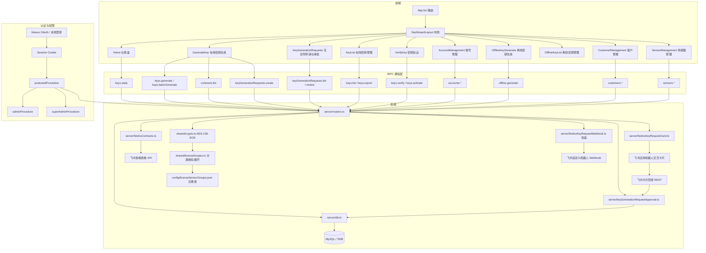

# 架构文档

> 本文档由 Manus 自动生成和维护。最后更新于：2026-10-26

## 1. 项目概述

授权平台统一管理 `shroom-desktop`（上位机）和 `shroom-sdk`（SDK），以独立 `productType` 区分。产品维度与在线/离线、量产/租赁、电脑数量相互独立；上位机保留传感器型号范围，SDK 不限制设备型号。历史未声明产品的密钥只归上位机。新版本管理页支持签发和辨认两种产品，同一密钥不跨产品使用。

**密钥管理系统（Key Manager）** 是一个基于 Shroom1.0 传感器项目衍生的独立 Web 应用，用于管理传感器设备的授权密钥。系统采用**三级权限体系**（超级管理员 → 管理员 → 子账号），支持两种密钥类型（**量产密钥**和**在线租赁密钥**）。密钥加密沿用 Shroom1.0 的 **AES-128/ECB** 固定密钥方案，与桌面客户端互通；授权范围支持 v3 **分类授权**（`@group:` 令牌，详见 §7.4），v1/v2 老密钥继续可解。

系统支持**在线密钥**和**离线密钥**两种模式。在线密钥采用"使用即激活"模式：后台生成密钥后发给客户，客户端通过 `keys.activate` 接口校验密钥有效性，首次调用即标记为已激活。离线密钥使用 RSA-SHA256 签名，支持机器码绑定的离线激活。

合同以飞书多维表格为唯一维护来源。合同管理页、在线/离线密钥生成页和设备码合同选择器统一通过 `contracts.list` 的 `source: "feishu"` 模式读取合同；Web 系统仅展示和绑定合同，不直接修改飞书合同数据。子账号按 `users.name` 与飞书 `提交人` 精确匹配，仅能读取同名提交人的全部合同；管理员和超级管理员可读取全部合同。飞书缺少事业部时，在权限过滤后按发起人姓名匹配系统账号当前所属部门，再按事业部、状态筛选并分页；同名账号部门不一致或未分配时不推断归属。

客户列表保留本地档案与归属权限，并从当前账号可见的飞书合同按归一化客户名称汇总部门和发起人。部门沿用合同的系统账号部门补全规则；同一客户可以显示多个部门、多个发起人，部分未匹配状态不被已匹配值覆盖，不使用客户建档账号代替合同发起人。该元数据只读且不入库；线上与本地分别查询各自数据库中的人员部门关系。

飞书合同在缓存阶段按归一化后的合同编号去重。普通账号的在线密钥必须绑定当前用户可见的飞书合同才能直接生成，客户名称由合同自动带入；无合同场景保存完整生成参数和申请原因，仅超级管理员可审批，批准时在同一数据库事务内生成密钥并更新申请状态。超级管理员可在确认弹窗选择“无合同生成”直接签发密钥，不创建审批申请。

在线密钥的单个、批量及复用生成页的限制密钥入口，在参数校验通过后始终先打开合同/无合同选择弹窗，不再因 `KEY_REQUIRE_CONTRACT=false` 跳过确认。合同路径选择可见飞书合同后签发；无合同路径在生成页对普通账号统一显示申请，填写原因后提交超管审批；超级管理员可直接签发。本次只调整生成页流程，不修改后端兼容开关：关闭强制绑定时直接 API 调用仍沿用原权限，不能把前端申请入口视为新增的服务端安全限制；飞书通知规则保持原样。

## 2. 技术栈

| 分类 | 技术 | 版本/说明 |
| :--- | :--- | :--- |
| **前端框架** | React 19 + Tailwind CSS 4 | SPA 单页应用，浅色主题 |
| **后端框架** | Express 4 + tRPC 11 | 类型安全的 RPC 通信 |
| **数据库** | MySQL / TiDB | 通过 Drizzle ORM 管理 |
| **编程语言** | TypeScript 5.9 | 前后端统一类型 |
| **包管理器** | pnpm 10 | 高效依赖管理 |
| **部署环境** | Manus Platform | 内置 OAuth 认证与托管 |
| **UI 组件库** | shadcn/ui + Radix UI | 无障碍组件体系 |
| **加密算法** | AES-128/ECB/Pkcs7 (CryptoJS) + RSA-SHA256 | 与桌面端互通；payload 带随机 `n`，离线激活码 RSA 签名 |
| **路由** | wouter | 轻量前端路由 |
| **数据序列化** | Superjson | tRPC 数据传输 |
| **测试** | Vitest | 141 个常规测试与 15 个显式启用的本机 MySQL 集成测试；覆盖授权、飞书、DOM 稳定性、Agent 同步和客户埋点/错误接收、归属隔离、事务回执及统计查询 |

## 3. 目录结构

```
key-manager/
├── client/                     # 前端应用
│   ├── src/
│   │   ├── _core/hooks/        # 核心 hooks（useAuth）
│   │   ├── components/         # 可复用 UI 组件
│   │   │   ├── ui/             # shadcn/ui 基础组件（按钮文本稳定化、Portal/提示禁翻译）
│   │   │   │   └── button.test.tsx # 加载状态按钮 DOM 结构测试
│   │   │   ├── KeyGenerationGateDialog.tsx # 合同绑定/无合同直生成或申请确认弹窗
│   │   │   ├── KeyCreatorSelect.tsx # 在线/离线、普通/限制密钥共用的可见生成人员筛选
│   │   │   ├── AccountPasswordResetDialog.tsx # 重置密码及独立账号启用状态提示
│   │   │   ├── AccountPasswordResetDialog.test.tsx # 禁用提示、表单校验及提交中状态测试
│   │   │   ├── BusinessUnitFilter.tsx # 客户/合同共用的事业部或全部筛选器
│   │   │   ├── BusinessUnitFilter.test.tsx # 筛选标签、默认值和失败重试测试
│   │   │   ├── OrganizationExportButton.tsx # 账号/部门页共用的超管 JSON 导出按钮
│   │   │   ├── OrganizationExportButton.test.tsx # 导出入口角色、启用和加载状态测试
│   │   │   ├── OperationsDashboard.tsx # 共用指标、可下钻横条分布及查询状态
│   │   │   ├── OperationsDashboard.test.tsx # 指标语义、错误状态及UTC日期补齐测试
│   │   │   ├── UsageDashboard.tsx # 使用趋势折线、功能与客户前8排行
│   │   │   ├── DashboardLayout.tsx  # Dashboard 布局（侧边栏导航 + 权限菜单）
│   │   │   └── ErrorBoundary.tsx
│   │   ├── contexts/           # React 上下文（主题等）
│   │   ├── hooks/              # 自定义 hooks
│   │   ├── lib/                # 工具库（trpc 客户端、utils）
│   │   ├── pages/              # 页面级组件
│   │   │   ├── Home.tsx        # 仪表盘（统计卡片 + 快速操作）
│   │   │   ├── GenerateKey.tsx # 在线密钥生成（单个 + 批量）
│   │   │   ├── GenerateKey.test.tsx # 生成前始终确认、合同参数和角色策略回归
│   │   │   ├── KeyGenerationRequests.tsx # 无合同申请列表与超管审批
│   │   │   ├── KeyList.tsx     # 在线密钥管理列表（筛选 + 分页 + 导出）
│   │   │   ├── LimitedKeys.tsx # 限制密钥生成/管理入口（在线/离线模式）
│   │   │   ├── VerifyKey.tsx   # 密钥验证（在线 + 离线 Tab）
│   │   │   ├── OfflineKeyGenerate.tsx # 离线密钥生成
│   │   │   ├── OfflineKeyList.tsx     # 离线密钥管理
│   │   │   ├── AccountManagement.tsx  # 账号管理
│   │   │   ├── DepartmentManagement.tsx # 部门管理及账号部门资料导出
│   │   │   ├── CustomerManagement.tsx # 客户看板及覆盖/状态筛选明细与档案管理
│   │   │   ├── ContractManagement.tsx # 合同看板及状态/在线开钥筛选明细
│   │   │   ├── UsageAnalytics.tsx     # 超管客户功能分析、时间线与错误上下文
│   │   │   ├── SensorManagement.tsx   # 传感器类型管理
│   │   │   ├── MacReader.tsx          # MAC 地址读取
│   │   │   └── NotFound.tsx    # 404 页面
│   │   ├── App.tsx             # 路由配置与布局
│   │   ├── const.ts            # 前端常量
│   │   ├── index.css           # 全局样式与主题变量
│   │   └── main.tsx            # 应用入口
│   └── public/                 # 静态资源（favicon 等）
├── server/                     # 后端逻辑
│   ├── _core/                  # 框架核心（OAuth、上下文、Vite 桥接）
│   │   ├── trpc.ts             # tRPC 初始化 + 三级权限中间件
│   │   ├── static.ts           # 独立静态资源服务，生产包不加载Vite
│   │   └── ...                 # 其他核心模块
│   ├── db.ts                   # 数据库查询 helpers（账号 + 密钥 CRUD）
│   ├── keyGenerationRequestTime.test.ts # 申请提交时间映射及审批/拒绝回归
│   ├── keyGenerationRequestTime.integration.test.ts # 本地 MySQL 临时表跨时区回归
│   ├── keyRequestNotifications.ts # 申请批准未读计数、超管待审批计数和本人已读回执
│   ├── keyRequestNotifications.test.ts # 计数与已读更新 SQL 的归属边界
│   ├── keyRequestNotificationsRouter.test.ts # 提醒接口身份、启用状态和输入校验
│   ├── licenseDeviceMode.ts    # 电脑授权分类 SQL、当前上限与离线签名格式判断
│   ├── routers.ts              # tRPC 路由定义（keys + accounts + auth + sensors + customers + offline）
│   ├── organizationExport.ts   # 全量账号/部门只读快照及安全字段投影
│   ├── organizationExport.test.ts # 导出白名单、关联、权限和审计回归
│   ├── organizationExport.integration.test.ts # 真实隔离 MySQL 全量导出事务测试
│   ├── managementDashboard.ts # 全范围客户/合同聚合及客户覆盖下钻条件
│   ├── managementDashboard.test.ts # 聚合口径、权限范围、来源失败及分页回归
│   ├── usage.ts                # 业务埋点/错误批量接收（鉴权、限额、提交后确认）
│   ├── usageSchema.ts          # 版本 1 白名单与错误脱敏
│   ├── usageStore.ts           # 不可变归属、事务去重、聚合与会话查询
│   ├── usageRouter.ts          # 启用中超管专用只读统计 API
│   ├── feishuContracts.ts       # 飞书合同读取、字段映射、编号去重和提交人过滤
│   ├── feishuContracts.test.ts  # 飞书合同去重与权限范围测试
│   ├── feishuContractDirectory.ts # 全量可见合同目录、部门补全及事业部选项/筛选
│   ├── feishuContractDirectory.test.ts # 事业部名称归一化与全部语义测试
│   ├── businessUnitFilter.integration.test.ts # 客户范围、筛选计数和分页的隔离 MySQL 测试
│   ├── contracts.department.test.ts # 合同部门补全、权限与缓存隔离测试
│   ├── feishuCustomerSync.ts    # 按可见合同客户名称去重建档及事务审计
│   ├── feishuCustomerMetadata.ts # 按可见合同汇总客户部门和发起人；来源失败保留本地档案
│   ├── customers.metadata.test.ts # 客户元数据聚合、分页、权限与失败降级测试
│   ├── feishuCustomerSync.test.ts # 客户名归一化与合同来源权限测试
│   ├── feishuCustomerSync.integration.test.ts # 客户导入、并发与回滚的 MySQL 测试
│   ├── customers.syncRouter.test.ts # 客户同步接口身份校验测试
│   ├── feishuKeyRequestWebhook.ts # 无合同密钥申请飞书机器人通知
│   ├── feishuKeyRequestWebhook.test.ts # Webhook 格式、失败隔离与安全校验测试
│   ├── feishuKeyRequestCard.ts # 飞书应用机器人审批卡片构建与发送
│   ├── feishuKeyRequestCardCallback.ts # 卡片回调解密、验签、群权限校验与响应
│   ├── keyGenerationRequestApproval.ts # 网站和飞书共用的申请审批服务
│   ├── onlineKeyGeneration.ts  # 在线密钥记录准备与生成
│   ├── keyGeneration.contractRequirement.test.ts # 在线生成合同必填测试
│   ├── licenseRegistry.ts      # 分类授权注册表磁盘加载 + SHA-256 + fail-fast 校验
│   ├── licenseScopes.test.ts   # 注册表校验、令牌解析、5 种授权范围展开测试
│   ├── cryptoLibParity.test.ts # crypto-lib.cjs 与 crypto.ts 的注册表/密钥互通一致性
│   ├── storage.ts              # S3 文件存储
│   ├── crypto.test.ts          # 加密模块 + v3 分类授权 + v1/v2 向后兼容测试
│   └── auth.logout.test.ts     # 登出测试（1 个用例）
├── config/
│   └── licenseSensorGroups.json # 分类与系统归属的唯一数据源（由桌面端同步，SHA-256 对齐）
├── drizzle/                    # 数据库 schema 与迁移
│   ├── schema.ts               # 含 licenseKeys、keyGenerationRequests 等业务表
│   ├── 0010_key_generation_requests.sql # 无合同申请与密钥关联迁移
│   ├── 0025_key_request_notifications.sql # 申请结果已读时间和通知计数组合索引
│   ├── 0011_key_soft_delete_columns.sql # 在线/离线密钥软删除字段兼容迁移
│   └── 0012_departments_table_compat.sql # 历史数据库部门表兼容迁移
├── shared/                     # 前后端共享
│   ├── crypto.ts               # AES-128-ECB 密钥生成/解码模块（ESM）
│   ├── crypto-lib.cjs          # 同上的自包含 CJS 副本（Electron 可 require）
│   ├── licenseScopes.ts        # 分类授权纯逻辑：注册表校验、@group: 令牌、范围展开
│   ├── const.ts                # 共享常量
│   └── types.ts                # 共享类型
├── obsidian-note-skill/        # 可上传的 Obsidian 笔记 skill 源目录
│   └── obsidian-note/
│       ├── SKILL.md             # 层级笔记生成与自动保存工作流
│       ├── agents/openai.yaml   # skill UI 元数据
│       └── scripts/save_markdown.py # UTF-8 原子保存与编码校验
├── obsidian-note-skill.zip     # Obsidian skill 上传包
├── scripts/listFeishuChats.ts  # 安全列出应用机器人可见群及 chat_id
├── scripts/build-deploy.mjs    # 自包含生产包、运行依赖闭包检查与白名单资源复制
├── scripts/ensure-local-mysql.mjs # Windows 本地开发前连接检查及启动兜底
├── scripts/start-local-mysql.ps1 # 现有 MySQL 数据目录的隐藏启动与并发保护
├── scripts/migrate-production.ts # 随包迁移器、目标绑定的成功摘要及强制检查
├── scripts/deploy-server.sh    # 低优先级发布、迁移、版本校验与dist回退
├── scripts/deploy-maintenance.mjs # 发布清单校验及有边界的历史清理
├── ops/wechat-mp-proxy/        # 独立公众号固定出口：Squid/stunnel 配置生成、安装和验收
│   ├── prepare.mjs             # 仅使用公开参数生成专用配置和 systemd 单元
│   ├── install.sh              # 服务器首次安装、证书检查和独立随机代理凭据
│   └── check.mjs               # 无公众号密钥的认证/目标白名单及双层TLS探测
├── server/wechatMpProxy.test.ts # 配置边界、敏感输出及真实回环TLS探测回归
├── docs/low-io-deployment.md   # 新CI路径、运维边界和验证说明
├── docs/crm-wechat-mp-proxy-handoff.md # CRM侧代理配置、无密钥探测、公众号业务联调及回退交接清单
├── docs/feishu-key-approval-setup.md # 飞书群内审批配置说明
├── package.json
├── todo.md                     # 功能追踪
└── ARCHITECTURE.md             # 本文档
```

### 关键目录说明

| 目录/文件 | 主要功能 |
| :--- | :--- |
| `client/src/pages/` | 10+ 个页面组件，对应多个路由 |
| `client/src/components/DashboardLayout.tsx` | 侧边栏按角色过滤菜单；密钥入口始终一级直达；设备工具、监控与安全、系统管理可折叠，当前路由分组自动展开，移动端选中菜单后关闭抽屉 |
| `server/routers.ts` | tRPC 路由，包含 keys、accounts、auth、sensors、customers、offline 多组 |
| `server/db.ts` | 数据库查询函数，含分级权限过滤 |
| `drizzle/schema.ts` | 14 张业务表，包含 users、departments、licenseKeys、keyGenerationRequests 等 |
| `shared/crypto.ts` | AES-128-ECB 密钥生成/解码核心，ESM 格式；v3 分类令牌在解码时展开 |
| `shared/crypto-lib.cjs` | 同上，自包含 CJS 格式，供 Electron 项目 `require()`；内联注册表快照，由 `server/cryptoLibParity.test.ts` 锁一致性 |
| `shared/licenseScopes.ts` | 分类授权纯逻辑（无 `fs`）：注册表校验、`@group:` 令牌、`expandLicenseFile`、中文展示名，前后端共用 |
| `config/licenseSensorGroups.json` | 分类与系统归属的**唯一数据源**，由桌面端 `E:\shroom1` 同步而来，详见 §7.4 |
| `server/licenseRegistry.ts` | 启动时按磁盘优先加载注册表，校验失败 fail-fast，并打印 SHA-256 |
| `obsidian-note-skill/obsidian-note/` | 将层级笔记自动保存为 UTF-8 Markdown；支持原子写入、同名避让和写后校验 |

## 4. 核心模块与数据流

### 4.1. 模块关系图 (Mermaid)



### 4.2. 主要数据流

**用户认证流程**：用户通过 Manus OAuth 或本地账号密码登录，系统根据 `openId` 或用户名匹配用户记录。首次登录的 Owner 自动设为 `super_admin` 角色，后续用户由上级创建并分配角色。被禁用的账号无法登录。

**在线密钥生成流程**：用户选择传感器类型、有效期和数量后打开合同确认弹窗。合同列表按编号去重，并依据历史密钥数量分为“未生成密钥”和“已生成密钥”；绑定当前账号可见的飞书合同后，后端再次校验合同 ID、编号和提交人范围，校验授权范围（未知系统、未知分类、空范围一律拒绝）后用 AES-128-ECB 生成密钥并自动写入合同客户。传感器类型可以选具体系统，也可以选「整个分类」——后者在密钥里保存 `@group:<key>` 令牌（§7.4）。普通账号直接调用 `keys.generate` / `keys.batchGenerate` 仍必须提交有效合同；超级管理员可省略合同直接生成，服务端基于登录角色进行最终校验。

**无合同审批流程**：普通账号在确认弹窗填写原因并调用 `keyGenerationRequests.create`，服务端保存传感器、有效期、数量和生成备注，写入审计后优先通过飞书应用机器人向 `FEISHU_APPROVAL_CHAT_ID` 指定的超管群发送交互卡片；卡片发送不可用时回退到 `FEISHU_KEY_REQUEST_WEBHOOK_URL` 文本提醒，通知故障不会回滚已经成功的申请。群内点击同意或拒绝后，`POST /api/feishu/key-request/card-action` 对回调执行 AES 解密、签名/Token、App ID、时间窗口及群 `chat_id` 校验，再调用与网站 `keyGenerationRequests.review` 共用的审批服务。批准时密钥写入与申请状态更新处于同一事务，生成的密钥归申请人所有并在密钥管理页可见；成功响应会将飞书卡片更新为最终状态，重复点击由申请状态锁拦截。超级管理员选择“无合同生成”时直接调用密钥生成接口，不写入申请表或发送申请通知。

**申请时间读取**：申请表由 MySQL 自动生成的 `createdAt`、`updatedAt` 使用 `UNIX_TIMESTAMP` 投影并转换成 JavaScript `Date`，避免 Drizzle 将会话时区的墙上时间误解析为 UTC。创建后回读、单条查询、列表及审批事务共用同一投影；前端仍按 `Asia/Shanghai` 展示。应用以 UTC 字符串写入的 `reviewedAt`、`generatedAt` 保留原映射，不对历史时间统一减八小时、不改变连接全局时区，也不迁移或重写历史记录。

**导航红点**：在线密钥分组直接显示“异常密钥”，保留管理员/超管权限；当前数据范围内仍有异常时持续亮红点。申请入口对超管显示全局待审批提醒，对所有登录账号显示本人未查看的批准结果。两类计数每 30 秒前台刷新，切回窗口时重新查询，后台不持续轮询；折叠导航和手机菜单按钮也保留提示及无障碍文字。申请列表只将当前可见页中本人的已批准结果写入 `resultReadAt`；后台页面、其他申请人、待审批结果和其他分页不被自动标记。失败保留未读，下一次列表刷新重试；已读状态由数据库保存，不依赖浏览器存储。

**账号创建流程**：管理员提交新增账号后，服务端写入 `users`，前端先刷新账号列表再关闭创建弹窗。账号查询通过 `users.departmentId` 左连接 `departments`；`0012_departments_table_compat.sql` 为历史数据库补齐部门表。Radix Dialog、AlertDialog 和 Select 的 Portal 节点统一禁止自动翻译，避免外部翻译脚本改写 React 管理的 DOM。

**前端 DOM 稳定性**：通用 `Button` 会将直接文本子节点归并到稳定的 `<span data-slot="button-label">` 中，并提供始终挂载、仅切换可见性的 `ButtonSpinner`。密钥生成弹窗的合同/无合同操作按钮以及生成页的占位区/结果区始终保留在 DOM 中，请求前后只更新属性和文本，避免浏览器翻译或扩展移动节点后触发 React `insertBefore`。Dialog、Sonner 等 Portal 根节点同时设置 `translate="no"` / `notranslate`；无合同申请与审批成功后先关闭弹窗并刷新查询，再显示成功提示。

**客户端统一接口流程**：客户收到密钥后，通过唯一的 `keys.activate` API 提交密钥。系统校验密钥有效性并在首次调用时标记为"已激活"，返回完整的授权信息（传感器类型、到期时间、剩余天数等）；被吊销/暂停/过期则返回失败。客户端每次启动时只需调用这一个接口即可。

**离线密钥流程**：通过机器码 + RSA-SHA256 签名生成离线激活码，客户端使用公钥验证签名。

**分级查看流程**：超级管理员可查看所有密钥；管理员可查看自己及其下属子账号的密钥；子账号仅可查看自己创建的密钥。

## 5. API 端点 (Endpoints)

| 方法 | 路径 | 权限 | 描述 |
| :--- | :--- | :--- | :--- |
| `tRPC` | `auth.me` | 公开 | 获取当前登录用户信息 |
| `tRPC` | `auth.logout` | 公开 | 用户登出 |
| `tRPC` | `auth.login` | 公开 | 本地账号密码登录 |
| `tRPC` | `keys.generate` | 登录 | 绑定并校验可见飞书合同后生成单个密钥；超级管理员可无合同直生成 |
| `tRPC` | `keys.batchGenerate` | 登录 | 绑定并校验可见飞书合同后批量生成；超级管理员可无合同直生成 |
| `tRPC` | `keys.list` / `offlineKeys.list` | 登录 | 在原有可见范围内按 createdById 等条件先筛选再计数、分页 |
| `tRPC` | `keys.creators` | 登录 | 按在线/离线及电脑授权分类查询可见、未删除密钥的生成人员，仅返回ID、姓名和用户名，不读取全量账号目录 |
| `tRPC` | `keys.verify` | 登录 | 验证/解密密钥 |
| `tRPC` | `keys.activate` | **公开** | 客户端统一接口：验证 + 首次激活 + 返回授权信息 |
| `tRPC` | `keys.changeCategory` | 超级管理员 | 更改密钥类型 |
| `tRPC` | `keys.stats` | 登录 | 获取密钥统计数据 |
| `tRPC` | `keys.export` | 登录 | 导出密钥（CSV/JSON），沿用列表可见范围与人员、搜索、状态、生成方式及电脑分类条件，最多10000条 |
| `tRPC` | `keys.clearTamper` | 启用中的管理员+ | 恢复原异常密钥并记录审计；管理员限本人及下属，超管可跨归属；拒绝缺失或已删除密钥，不重签、不延长到期、不修改电脑策略 |
| `tRPC` | `accounts.*` | 管理员+ | 账号管理 CRUD |
| `tRPC` | `accounts.exportOrganization` | 启用中的超级管理员 | 导出全量账号/部门及名称关联的版本化 JSON，排除密码和私密联系资料，禁止响应缓存并记录数量审计；不提供导入 |
| `tRPC` | `customers.*` | 登录 | 客户管理 CRUD；list 可选 businessUnit，先按可见合同匹配客户ID，再在原有归属、搜索和状态条件下计数及分页；附加部门/发起人元数据 |
| `tRPC` | `customers.syncFeishu` | 启用中的登录账号 | 从当前可见飞书合同去重创建缺失客户，保留已有资料与状态；新客户归执行同步的账号 |
| `tRPC` | `customers.dashboard` | 启用中的登录账号 | 在归属、搜索、事业部范围内汇总全部客户、合同覆盖和部门分布；来源失败不伪造0。list 新增 coverage 下钻，先筛选后计数分页 |
| `tRPC` | `sensors.*` | 超级管理员 | 传感器类型管理 |
| `tRPC` | `sensors.licenseGroups` | **公开** | 分类授权清单（`@group:` 令牌 + 各分类当前成员 + 注册表 SHA-256） |
| `POST` | `/licenseCheck` | **公开** | 在线校验：请求含 key、productType（省略为上位机）、clientTime 和可选64位hex deviceId；返回权威产品、状态、到期、展开范围、SDK功能和最长60秒 leaseExpiresAt；SDK必须有同产品登记记录 |
| `POST` | `/api/license/devices/check` | **公开** | 限量离线码联网绑定：验证RSA签名、数据库产品及请求产品一致后占用电脑名额，返回产品、范围、SDK功能和最长60秒租约；支持浏览器JSON预检 |
| `GET` | `/sensorTypes` | **公开** | 纯 REST 传感器清单 + `licenseGroups` + `registrySha256`；DB 异常时回退注册表派生清单 |
| `GET` | `/healthz` | **公开** | 禁止缓存的进程/构建检查，返回ok和运行提交SHA，不返回配置或凭据；不代表数据库或飞书健康 |
| `tRPC` | `offline.*` | 登录 | 离线密钥生成与管理 |
| `tRPC` | `contracts.list` | 登录 | 读取按合同编号去重的飞书合同，按发起人系统所属部门补全缺失事业部，可选 businessUnit 与状态组合筛选后计数和分页，并返回已生成密钥数量 |
| `tRPC` | `contracts.businessUnits` | 启用中的登录账号 | 汇总全部可见合同的已解析事业部，名称去重排序；子账号不暴露其他提交人的选项，来源异常明确报错 |
| `tRPC` | `contracts.dashboard` | 启用中的登录账号 | 全可见去重合同的状态、在线开钥覆盖和部门分布；list 新增 issuance，在分页前按在线历史生成记录筛选 |
| `tRPC` | `keyGenerationRequests.create` | 登录 | 提交包含完整生成参数的无合同密钥申请 |
| `tRPC` | `keyGenerationRequests.list` | 登录 | 超管查看全部申请，其他账号仅查看本人申请 |
| `tRPC` | `keyGenerationRequests.notifications` | 启用中的登录账号 | 返回本人未读批准数和仅超管可见的全局待审批数，不返回申请明细，禁止缓存 |
| `tRPC` | `keyGenerationRequests.markResultsRead` | 启用中的登录账号 | 接收当前页 1 至 100 个申请 ID，仅标记本人的已批准未读结果，重复调用不覆盖原已读时间 |
| `tRPC` | `keyGenerationRequests.review` | 超级管理员 | 批准并事务生成密钥，或填写原因拒绝申请 |
| `POST` | `/api/feishu/key-request/card-action` | 飞书验签 + 指定审批群 | 接收应用机器人卡片操作并调用统一审批服务 |
| `POST` | `/api/usage/events/batch` | 有效登记软件密钥 | ≤50 条白名单埋点/错误，事务去重，提交后确认全部 ID |
| `tRPC` | `usage.customers/overview/events/context` | 启用中的超级管理员 | 客户功能统计、日期/环境/模块/版本筛选、分页事件和同会话上下文 |
| `tRPC` | `usage.dashboard` | 启用中的超级管理员 | 相同历史归属和业务证据口径的UTC日趋势、前8业务功能与客户排行；最多93天，禁止响应缓存 |
| `tRPC` | `system.notifyOwner` | 登录 | 向 Owner 发送通知 |

## 6. 数据库表结构

| 表名 | 主要字段 | 说明 |
| :--- | :--- | :--- |
| `users` | id, username, password, role, createdById, teamId, phone, managedGroups, departmentId, isActive | 三级角色用户表；`0009_user_profile_columns.sql` 补齐账号资料与部门字段 |
| `licenseKeys` | id, keyString, sensorType, days, category, contractId, contractNo, generationRequestId, customerName, isDeleted | 在线密钥表；支持合同生成、无合同审批生成和超管无合同直生成 |
| `keyGenerationRequests` | id, requestNo, sensorTypes, days, count, reason, requestedById, status, reviewer, generatedBatchId, resultReadAt | 无合同密钥申请、审批结果及申请人已读时间；通知组合索引覆盖 status/requestedById/resultReadAt |
| `departments` | id, name, sensorGroup, managerId, createdAt, updatedAt | 账号部门及传感器分组；`0012_departments_table_compat.sql` 为旧库补齐 |
| `customers` | id, name, contactPerson, phone, isActive | 客户表 |
| `sensor_types` | id, value, label, groupName, groupIcon, sortOrder | 传感器类型表 |
| `offline_keys` | id, machineId, activationCode, sensorType, days | 离线密钥表 |
| `rsa_key_pairs` | id, publicKey, privateKey, isActive | RSA 密钥对表 |
| `usage_sources` | source_id, customer_id, customer_name, first_received_at | 首次上传时固定的客户归属快照；来源复用软件密钥稳定 ID |
| `usage_events` | source_id, installation_id, event_id, session_id, occurred_ms, event_name, payload_hash, payload_json | 脱敏事件兼去重回执，索引支持环境/日期、客户来源、错误及会话查询 |

## 7. 加密模块

### 7.1. 算法说明

密钥加密沿用 Shroom1.0 的 **AES-128/ECB/Pkcs7**（CryptoJS，固定密钥），保证桌面端与发证服务的密钥互通。ECB 无 IV 也无认证标签，因此：

| 特性 | 现状 | 补偿手段 |
| :--- | :--- | :--- |
| IV 随机性 | 无（ECB） | payload 里加随机 `n` 字段，避免相同参数产出相同密文 |
| 认证标签 | 无 | 篡改后解密出的明文 JSON 解析失败 → `decodeLicenseKey` 判 `valid: false` |
| 篡改检测 | 靠上层 JSON 解析 | 离线激活码另有 RSA-SHA256 签名；在线校验有服务端记录与防回拨高水位 |

离线激活码与在线校验的完整性依赖签名和服务端状态，不依赖对称加密本身。

### 7.2. 密钥格式

密钥字符串为 AES-ECB 密文的 hex 编码（无 IV / 无认证标签前缀）。

加密载荷 JSON 格式：`{"date": <到期时间戳>, "file": <授权范围>, "cat": "<production|rental>", "v": <2|3>, "n": "<随机 nonce>"}`。

`file` 就是授权范围本身，共 5 种形态（详见 7.4）：`"all"` / 单个系统 key / 系统数组 / `"@group:<groupKey>"` 分类令牌 / 分类与系统混合数组。含分类令牌时 `v: 3`，否则 `v: 2`。

### 7.3. Electron 集成

将 `shared/crypto-lib.cjs` 复制到 Electron 项目中，通过 `require('./crypto-lib.cjs')` 引入即可使用 `decodeLicenseKey()` 函数验证密钥。依赖 `crypto-js` npm 包。

该文件是自包含副本：内联了一份注册表快照，同时会尝试 `require("./licenseSensorGroups.json")`——集成方把注册表 JSON 放到同目录即可覆盖内联快照，不必改代码；也可以调用导出的 `setLicenseSensorGroups(groups)` 在运行时注入。`server/cryptoLibParity.test.ts` 锁住它与 `shared/crypto.ts` 的注册表内容和密钥互通行为。

### 7.4. 分类授权注册表（v3 `@group:` 令牌）

**要解决的问题**：以前按固定系统数组签发密钥，往某个分类里新增系统后，所有老客户都得重新发证。

**做法**：分类密钥在 payload 的 `file` 里保存**稳定的 `@group:<groupKey>` 令牌**，而不是签发当时展开的系统数组；展开发生在**解码/校验时**。于是往分类里新增系统后，未过期的旧分类密钥在新版客户端就自动获得新增系统，无需重新发证；而用固定数组签发的老密钥不会越权拿到新增系统。

**唯一数据源**：`config/licenseSensorGroups.json`（5 个分类 / 27 个系统），与桌面端使用相同的稳定系统 key。服务端不得再维护第二份手写分类数组；新增/移动系统时应核对两仓库的历史类型差异，再同步对应注册项及自包含快照：

```bash
cd /e/shroom1 && node scripts/sync-license-registry.cjs E:\key\config\licenseSensorGroups.json
```

**加载顺序**（`shared/licenseScopes.ts` + `server/licenseRegistry.ts`）：

1. 构建内联：`shared/licenseScopes.ts` 静态 `import` 该 JSON 作为兜底，导入即校验（校验失败进程起不来）。
2. 运行时磁盘优先：`startServer()` 一开始调用 `loadLicenseRegistry()`，先读显式 `LICENSE_REGISTRY_PATH`，否则优先随生产包的 `dist/config/licenseSensorGroups.json`，再使用 `<cwd>/config/licenseSensorGroups.json`；存在就覆盖内联快照，并打印 `分类数 / 系统数 / sha256`。外部路径仍需单独同步，自包含CI默认注册表与dist共同发布和回退。
3. **fail-fast**：文件存在但 JSON 非法、分类 key 重复、系统 value 重复、分类为空 → 抛错终止启动，绝不退回空列表继续签发。文件缺失只 warn 并沿用内联快照。

**模块分工**：`shared/licenseScopes.ts` 是纯逻辑（不碰 `fs`），前端也直接 import；`server/licenseRegistry.ts` 只负责磁盘加载与 SHA-256。DB 的 `sensor_types` 表只保留中文显示名，分类归属一律读注册表（`buildDefaultSensorTypes()` 从注册表派生默认清单）。`LICENSE_GROUP_META[key].dbGroupName` 必须与 `sensor_types.groupName` 逐字一致——`departments.sensorGroup` 就是按这个字符串绑定部门的。

**压力传感背心**：`precision` 精密分类新增 `pressureVest`（`labelKey: sensorPressureVest`），`SENSOR_LABELS` 显示为“压力传感背心”，`shared/crypto-lib.cjs` 通过注册表快照脚本同步。在线、批量及离线生成页面统一读取 `sensors.groups` 的数据库清单，分类授权通过 `sensors.licenseGroups` 读取注册表，无需新增前端手写选项。启动或调用 `ensureDefaultSensorTypes()` 后补齐数据库类型；不改变既有固定数组密钥，未过期精密分类密钥按当前注册表展开时可包含背心。

**兼容矩阵**：

| 版本 | `file` 形态 | 展开语义 | 随分类更新 |
| :--- | :--- | :--- | :--- |
| v1（无 `v` 字段） | `"all"` / 单系统 | 原样 | 否 |
| v2 | `"all"` / 单系统 / 系统数组 | 原样 | 否 |
| v3 | `"@group:precision"` / `["@group:care","humanBodyOptimized"]` | 按当前注册表展开分类，混合项按请求顺序去重 | **是** |

`"all"` 按当前注册表展开；真正的“全部授权”语义由 `isAllTypes: true` 承载。旧 `humanBody`（人体全身）已退出注册表并保持停用，现行全身系统仅为 `humanBodyOptimized`（人体全身传感）；已有固定数组密钥仍可按原值解码，但新密钥不会再提供旧值。未知 `@group:` 一律判无效（`valid: false`），**不会**降级成普通系统 key，也不会变成“授权 0 个系统但有效”。

**接口出口**：`POST /licenseCheck` 返回展开后的 `sensorTypes` + `isAllTypes` + `groupKeys` + 原始 `scope`；`GET /sensorTypes` 与 `sensors.licenseGroups` 返回 `licenseGroups` 与 `registrySha256`（与桌面端比对可确认两边分类归属同步）。客户端判权限只看 `sensorTypes`/`isAllTypes`，不要自己解析令牌。

**部署顺序**：桌面端注册表更新后必须**先**同步到 `config/` 并重启发证服务，再发新版客户端。

### 7.5. Agent 聊天同步

`server/agentSync.ts` 在全局正文解析器之前注册 `POST /api/agent/conversations`，先用软件密钥或独立 Bearer 凭证鉴权，再校验 8 MiB 以内的白名单快照。`agentSyncSchema.ts` 对齐桌面端版本 1 契约；归属由服务器登记的密钥或凭证确定。

`agentSyncStore.ts` 在事务内锁定事件回执、校验请求摘要并按 revision 原子更新最新快照，提交后才 ACK。旧版成功确认但不覆盖新版，同事件不同内容返回 409。迁移 `0013_agent_chat_sync.sql` 增加 `agent_upload_credentials`、`agent_conversations`、`agent_sync_events` 三张 InnoDB 表；ID 使用区分大小写的索引。

`agentSyncRouter.ts` 提供启用中超管专用的凭证签发/列表/撤销接口；`scripts/agentSyncCredential.ts` 提供本机运维命令。凭证仅保存 SHA-256 摘要、固定客户归属、上传权限与有效期，明文仅签发时返回。接口每进程每客户限流 60 次/分钟，12 秒未完成返回 503，重试由数据库回执去重。详细部署、反向代理配置及接入步骤见 `docs/agent-chat-sync-service.md`。

`client/src/pages/AgentChats.tsx` 提供 `/agent-chats` 只读查看页，左侧菜单入口为“监控与安全 → Agent 聊天”。`agentSync.chatCustomers`、`conversations`、`conversation` 查询均限启用中超管使用；按客户筛选、以客户/安装/会话复合键定位详情。列表仅返回限长预览，消息与任务各每页 50 条，每 30 秒刷新。消息以纯文本展示，附件只显示元数据；服务端生成的同步时间按数据库 epoch 读取，避免会话时区引入显示偏差。客户端必须先成功上传，页面才会有记录。

2026-09-23 新增 `Authorization: License <软件密钥>`，每次检查服务器登记、授权范围、到期时间、删除/暂停/吊销/异常状态和关联客户可用性，数据库错误时不放行。独立 Bearer 凭证继续兼容。迁移 `0014_agent_chat_license_auth.sql` 新增 `agent_chat_sources`，保留旧客户来源 ID 并为每个软件密钥分配稳定来源；聊天/回执 `tenant_id` 指该来源 ID。展示名称优先关联客户、其次密钥冗余公司名，否则按密钥标记未绑定公司；不使用客户端自报归属。密钥变更公司不移动会话历史，来源保持隔离。对应桌面端仅向固定官方 HTTPS 接口自动发送软件密钥，按密钥摘要隔离队列；上线须同步更新服务端与客户端。

### 7.6. 客户功能使用与错误上报

`server/usage.ts` 在全局正文解析之前注册 `POST /api/usage/events/batch`，复用已有软件密钥校验；只接收版本 1、每批至多 50 条/256 KiB、单事件至多 4 KiB 的严格白名单。普通行为和 `error_reported` 共用批次，错误消息/堆栈另行限长与脱敏。每来源每进程 60 批/分钟，12 秒接收超时；所有错误响应只含固定错误码。

`usageStore.ts` 在同一 InnoDB 事务中首次固定来源的客户 ID/名称，按来源/安装/事件 ID 写不可变记录并比对内容摘要；完全重复的重传正常 ACK，内容冲突导致整批回滚。公司绑定变化不会把既有行为移给别的客户，同一密钥后续记录保持首次归属。迁移 `0015_usage_analytics.sql` 只增加两张 usage 表及索引，不执行在线数据回填或自动迁移。

`/usage-analytics` 入口为“监控与安全 → 客户使用分析”，查询只向启用中的超管开放。按 UTC 事件日期（至多 93 天）、环境、客户、版本、错误模块筛选；SQL 聚合全部匹配记录，排行各限前 100 条并明确标注，时间线每页 50 条。错误次数按客户端重复聚合的 count 累加，不同错误按脱敏指纹去重；详情上下文只匹配同来源/安装/会话最近 20 条。空数据明确表示未观测到，不能等同未使用；记录发生与接收时间分别显示。

接入部署顺序、字段契约、统计口径及验证边界见 `docs/usage-analytics-service.md`。当前为代码完成、本机隔离数据库与合成浏览器数据验证；未执行生产迁移、发布或真实客户上传。未新增运行时依赖，构建产物均位于系统临时目录。

2026-09-24 覆盖扩展：管理查询增加 `featureId` 精确筛选，`overview.systems` 对匿名 systemType 分组前 100 项；客户表分别累加 foreground/interaction 会话摘要，监测与采集仍只累计对应业务事件。`client/src/lib/usagePresentation.ts` 统一固定功能标签、匿名系统标签及 MiB/ms/长任务/帧间隔单位；页面增加系统表、功能筛选和前台/交互列，手机表格内部横向滚动。上传 schemaVersion 1 与事件属性不变，不增加 SQL 迁移。首版线上路由和菜单资源已可观察，本轮扩展仍为未发布的隔离工作区代码，不能据此宣称真实客户数据已验收。

## 8. 环境变量

| 变量名 | 描述 |
| :--- | :--- |
| `DATABASE_URL` | 数据库连接字符串 |
| `USAGE_TEST_ADMIN_URL` | 仅显式启用本机 MySQL 集成测试；测试创建并删除自己的随机数据库，不用于运行时 |
| `LICENSE_REGISTRY_PATH` | 分类授权注册表路径，默认 `<cwd>/config/licenseSensorGroups.json`；文件非法则启动失败（见 7.4） |
| `JWT_SECRET` | Session Cookie 签名密钥 |
| `VITE_APP_ID` | Manus OAuth 应用 ID |
| `OAUTH_SERVER_URL` | Manus OAuth 后端地址 |
| `VITE_OAUTH_PORTAL_URL` | Manus 登录门户地址 |
| `OWNER_OPEN_ID` | 项目 Owner 的 OpenID |
| `OWNER_NAME` | 项目 Owner 名称 |
| `BUILT_IN_FORGE_API_URL` | Manus 内置 API 地址 |
| `BUILT_IN_FORGE_API_KEY` | Manus 内置 API 密钥 |
| `FEISHU_CONTRACTS_ENABLED` | 是否启用飞书合同表来源（`true`/`1`） |
| `FEISHU_APP_ID` | 飞书自建应用 App ID |
| `FEISHU_APP_SECRET` | 飞书自建应用 App Secret |
| `FEISHU_CONTRACT_BASE_URL` | 飞书多维表格 Base 或知识库 `/wiki/` 原表链接；知识库通过节点解析获取底层表格 token，需要应用身份权限 `wiki:node:read` 及节点访问权限 |
| `FEISHU_CONTRACT_BASE_APP_TOKEN` | 飞书多维表格 app token（可替代 Base 链接） |
| `FEISHU_CONTRACT_TABLE_ID` | 飞书多维表格 tableId；优先于链接中的 `table` 参数，均不填时默认读取第一个数据表 |
| `FEISHU_CONTRACT_VIEW_ID` | 飞书多维表格 viewId（可选，用于限定视图）；优先于链接中的 `view` 参数 |
| `FEISHU_CONTRACT_SPREADSHEET_TOKEN` | 飞书合同电子表格 token（也可用 `FEISHU_CONTRACT_SPREADSHEET_URL`） |
| `FEISHU_CONTRACT_SHEET_ID` | 飞书合同表 sheetId（当 range 未带 sheetId 时使用） |
| `FEISHU_CONTRACT_RANGE` | 飞书合同表读取范围，如 `sheetId!A1:H500` 或 `A1:H500` |
| `FEISHU_CONTRACT_CACHE_TTL_MS` | 飞书合同列表缓存时间，默认 5 分钟 |
| `FEISHU_KEY_REQUEST_WEBHOOK_URL` | 接收无合同密钥申请提醒的飞书自定义机器人 Webhook |
| `FEISHU_APPROVAL_CHAT_ID` | 应用机器人发送审批卡片且允许执行审批的超管群 chat_id |
| `FEISHU_VERIFICATION_TOKEN` | 飞书应用卡片回调 Verification Token |
| `FEISHU_CALLBACK_ENCRYPT_KEY` | 飞书应用回调 Encrypt Key；配置后启用解密与签名校验 |
| `FEISHU_APPROVAL_REVIEWER_USERNAME` | 飞书群审批写入审计记录时对应的系统超级管理员用户名 |

生产部署不提交 `.env`。`.github/workflows/deploy.yml` 从 GitHub Actions Secrets 读取数据库、JWT 和飞书配置，每次部署在服务器重新生成 `/opt/key-manager/.env`，再通过 PM2 的 `--update-env` 重新加载。

公司系统包客户接口在 `server/systemPackages.ts` 同时识别在线 AES 密钥与已登记的离线 RSA 激活码。离线码按 `offlineKeys` 原文匹配，用签发时的 `rsaKeyPairs.publicKey` 验签，再核对到期及密钥状态；两种密钥直接以自身系统范围决定可下载的已发布系统，客户关联不再是授权前置条件。`server/systemPackageClientLicense.ts` 承担签名范围校验，403 错误码区分未登记、停用和过期。在线单个/批量及离线生成页可直接选择已发布公司系统，不再要求额外选客户；离线原有客户字段仍为可选业务元数据。

系统包身份由稳定 `system_id` 和可空的 `base_version` 区分首次发布与更新；`0018_brief_fixer.sql` 加入基线列。提交与发布锁定同 ID 版本记录，已发布 ID 必须显式指定当前版本，内置 ID/传感器类型及并行待审受拦截；超级管理员审核页再次确认版本。客户本机冲突仍由安装器保护草稿，不由服务器猜测或覆盖客户数据。

`0019_handy_gwen_stacy.sql` 新增 `system_package_rollouts`，将不可变已发布包与客户当前使用版本分离。`server/systemPackages.ts` 用可选客户专属指针优先、全体默认指针兜底，历史无适用指针时保留最新已发布版本读取兼容；新版审核事务冻结缺失默认、后续版本仅成候选，忽略旧发布客户名单；目录和下载始终核对密钥系统 ID。客户缺失不阻断授权；明确指针指向撤回或缺失版本时不自动回退。仅 `super_admin` 可在管理页推广或回退，更新以 `expectedRolloutToken` 防止陈旧页面覆盖并写审计；全体推广清除客户覆盖。员工 `sps_` 令牌只读取得已发布原包供桌面创建独立修订草稿，不能发布或读取客户目录。同 ID 更新校验传感器身份/矩阵尺寸，审核显示协议与线序变化。

公司系统发布要求生产机有与桌面端公钥配对的签名私钥。`.github/workflows/deploy.yml` 在重写 `/opt/key-manager/.env` 前检查 `/opt/key-manager-secrets/system-package-private.pem` 可读，并把其绝对路径写为 `SHROOM_SYSTEM_PACKAGE_SIGNING_KEY_PATH`，同时传入 PM2 重启环境，避免部署后丢失配置。审核页把签名配置缺失翻译为中文并在发布按钮旁显示失败原因；只有发布接口确认成功才称“已发布”，后续详情刷新失败单独提示。

## 9. 项目进度

| 完成时间 | 分支 | 完成的功能/工作 | 说明 |
| :--- | :--- | :--- | :--- |
| 2026-03-06 10:31 | main | 项目初始化 | React 19 + tRPC + Drizzle ORM 基础架构 |
| 2026-03-06 10:31 | main | 用户认证模块 | Manus OAuth 登录/登出 |
| 2026-03-06 10:31 | main | 原始密钥系统分析 | 分析 Shroom1.0 的 AES-ECB 加密逻辑 |
| 2026-03-06 21:50 | main | 数据库 schema | users 表（三级角色 + 层级关系）+ licenseKeys 表（量产/租赁 + 激活状态） |
| 2026-03-06 21:50 | main | AES-256-GCM 加密模块 | 独立可导出，ESM + CJS 双格式，Electron 可直接 require |
| 2026-03-06 21:50 | main | 三级权限中间件 | super_admin / admin / user 权限检查 |
| 2026-03-06 21:50 | main | 完整后端 API | 密钥生成/批量/验证/激活/统计/导出 + 账号管理 CRUD |
| 2026-03-06 21:50 | main | 前端全部页面 | 仪表盘、密钥生成、密钥管理、密钥验证、账号管理 5 个页面 |
| 2026-03-06 21:50 | main | 暗色主题 | 专业暗色配色方案，OKLCH 色彩空间 |
| 2026-03-06 21:50 | main | Vitest 测试 | 16 个测试用例全部通过（加密/解密/生成/解码/篡改检测） |
| 2026-03-19 19:25 | main | 在线密钥设备绑定重构 | 新增 keyDevices 表、maxDevices 字段，客户自助激活绑定模式 |
| 2026-03-19 19:25 | main | 设备管理 API | activate（公开）、devices、unbindDevice 三个新端点 |
| 2026-03-19 19:25 | main | 前端设备管理 | 生成页面添加设备数量限制，列表页面显示设备绑定信息和解绑功能 |
| 2026-03-19 19:25 | main | 设备绑定测试 | 新增 6 个测试用例，总计 31 个测试全部通过 |
| 2026-07-21 | main | 前端 DOM 稳定性修复 | `client/index.html` 设置 `lang="zh-CN"` 并禁用自动翻译，避免浏览器翻译改写 React 根节点导致生成密钥时崩溃 |
| 2026-07-23 | main | 密钥默认有效期调整 | 在线密钥和离线密钥生成页面默认有效天数改为 30 天 |
| 2026-07-24 | main | 飞书合同表接入 | 新增 Feishu Sheets/Base 合同读取模块，生成密钥和离线密钥绑定合同列表改为来自飞书表格 |
| 2026-07-30 | main | 用户表迁移修复 | 新增 `0009_user_profile_columns.sql`，为旧数据库补齐 phone、managedGroups、departmentId 字段，恢复登录初始化 |
| 2026-07-30 | main | 合同管理统一飞书数据源 | 合同管理页切换为飞书只读列表，使用飞书记录 ID 区分重复合同编号，并增加刷新、加载、空列表和读取失败状态 |
| 2026-07-30 | main | 飞书合同字段展示 | 合同列表新增事业部和提交人，移除与合同编号重复的标题；密钥生成合同选项改为显示合同编号和客户名称 |
| 2026-07-30 | main | 子账号合同数据权限 | 子账号合同列表按账号姓名匹配飞书提交人，设备码合同选择器统一切换为飞书只读数据源 |
| 2026-07-30 | main | 合同生成确认与编号去重 | 飞书合同按归一化合同编号去重，在线生成改为弹窗绑定合同并按是否已生成密钥分类 |
| 2026-07-30 | main | 无合同密钥审批 | 新增申请列表、超管审批、事务自动生成和申请人结果查看，并补齐密钥软删除兼容迁移 |
| 2026-07-30 | main | 超管无合同直生成 | 超级管理员可跳过审批直接生成在线密钥，普通账号仍需绑定合同或提交申请 |
| 2026-07-30 | main | 新增人员兼容修复 | 补齐历史数据库 `departments` 表，并保护弹窗 Portal DOM，恢复账号创建后的列表刷新 |
| 2026-07-30 | main | 申请审批 DOM 稳定性 | 通用按钮使用稳定标签元素，无合同申请和超管审批顺序刷新，新增客户端结构测试 |
| 2026-07-30 | main | 超管无合同直生成 DOM 修复 | 加载图标、弹窗操作按钮及生成结果区改为固定节点结构，真实生成回归无浏览器错误 |
| 2026-07-30 | main | Obsidian Markdown 自动保存修复 | 笔记默认自动落盘，新增 UTF-8 原子保存、标题校验、同名文件避让并重新打包上传 ZIP |
| 2026-07-30 | main | 密钥申请飞书通知 | 普通账号提交无合同密钥申请后自动推送飞书提醒，通知故障不影响申请入库 |
| 2026-07-30 | main | 飞书群内快速审批 | 应用机器人发送可交互审批卡片，指定超管群可免登录同意或拒绝，并与网站共用事务审批逻辑 |
| 2026-08-19 | main | 分类授权（v3 `@group:` 密钥） | 引入 `config/licenseSensorGroups.json` 唯一数据源与 `shared/licenseScopes.ts`，密钥保存分类令牌、解码时展开；生成/离线页支持「整个分类」，各列表与 `/licenseCheck`、`/sensorTypes` 同步；测试从 53 增至 115 个 |
| 2026-09-16 | main | 人体全身系统名称校准 | 停用旧“人体全身”后，将 `humanBodyOptimized` 的显示名统一为“人体全身优化系统”，协议值保持不变 |
| 2026-09-16 | main | 人体全身传感命名 | 将现行全身系统显示名调整为“人体全身传感” |
| 2026-09-22 | main | Agent 聊天同步接收服务 | 新增客户上传凭证、严格事件校验、事务回执去重与版本控制，提供超管管理 API 和运维命令 |
| 2026-09-22 | main | Agent 聊天网页查看 | 新增超管专用聊天菜单、客户筛选、消息及任务分页，完成桌面和手机端浏览验证 |
| 2026-09-23 | main | Agent 软件密钥上传 | 有效密钥直接上传，自动显示公司名，未绑定公司按密钥隔离；新增来源迁移与失效/续期回归 |
| 2026-09-24 | codex/usage-errors-analytics | 客户使用分析与错误接收 | 完成事务批量接收、固定客户归属、超管统计/时间线/错误上下文页和 14 项专项测试；尚未上线 |
| 2026-09-24 | codex/usage-errors-analytics | 诊断凭据脱敏加固 | 凭据键值支持 JSON、单双引号、空格和转义引号，新增完整值回归，专项 HTTP/权限 10 项通过 |
| 2026-09-24 | codex/usage-errors-analytics | 使用统计范围扩展 | 功能筛选、匿名系统排行、前台/交互窗口与性能单位；完整 159 项含临时 MySQL、类型检查、临时构建和浏览器验证通过，本轮未发布 |
| 2026-10-08 | 当前分支 | 离线码公司系统同步鉴权 | 客户目录与下载接口接纳已登记的 RSA 激活码，离线生成页可勾选公司系统并要求关联客户；需部署后生效。 |
| 2026-10-08 | 当前分支 | 公司系统 ID 冲突保护 | 新系统占用已发布 ID 须显式作为当前版本更新；审核发布再次核对基线，内置 ID 与并行待审被拦截；需应用 0018 迁移。 |
| 2026-10-08 | 当前分支 | 公司系统按客户版本控制 | 超管可推广已发布版本或为指定客户回退；目录只分发当前指针，员工可读取原包创建本机修订草稿；需应用 0019 迁移并完成真实 MySQL 验收。 |
| 2026-10-09 | 当前分支 | 公司系统签名部署与发布反馈 | 部署前检查配对私钥并持久写入路径；发布失败在审核按钮旁显示中文原因，避免待审核系统被误认为已交付。 |
| 2026-10-19 | main | 候选发布、上传保留与诊断策略 | 首次默认基线、候选显式推广、安全幂等回填；180/90天有界清理、超管删除审计与防重放墓碑；签名只读策略及可选运行版本。 |

## 10. 更新日志

| 时间 | 分支 | 变更类型 | 描述 |
| :--- | :--- | :--- | :--- |
| 2026-10-19 | main | 新增功能 | 区分候选发布与推广；新增上传保留/删除、0022迁移、签名诊断policy与运行版本白名单，完整常规及本机隔离事务测试通过，未部署生产。 |
| 2026-03-06 10:31 | main | 初始化 | 创建项目架构文档 |
| 2026-03-06 21:50 | main | 新增功能 | 完成全部核心功能：三级权限、密钥生成/验证/管理、账号管理、AES-256-GCM 加密、暗色主题 |
| 2026-03-19 19:25 | main | 优化重构 | 在线密钥从“后台绑定设备”改为“客户自助激活绑定”模式：新增 keyDevices 设备绑定表、maxDevices 设备数量限制、公开激活 API、管理员解绑功能 |
| 2026-03-20 11:55 | main | 优化重构 | 合并客户端 3 个接口为 1 个统一 activate 接口（自动绑定+验证+返回授权信息）；移除 verifyOnDevice 接口 |
| 2026-03-20 11:55 | main | 新增功能 | API 文档页面添加一键复制功能（HTTP 调用示例 + Python 代码示例） |
| 2026-07-02 | main | 优化重构 | 移除设备绑定/设备数量限制：删除 keyDevices 表、maxDevices 字段、keys.devices/unbindDevice 接口及前端相关展示；activate 保留为"使用即激活"（不再绑定设备） |
| 2026-07-21 | main | 修复缺陷 | 修复生成密钥后 React `insertBefore` 异常：前端入口声明中文页面并对 `html`、`body`、`#root` 添加 `translate="no"` / `notranslate` |
| 2026-07-23 | main | 配置变更 | 将在线密钥和离线密钥生成表单的默认有效天数从 365 天改为 30 天，默认高亮 30 天预设 |
| 2026-07-24 | main | 新增功能 | `contracts.list` 支持 `source: "feishu"`；生成密钥和离线密钥页面的合同下拉只读取飞书 Sheets/Base，不再提供本地新建合同入口 |
| 2026-07-30 | main | 修复缺陷 | 修复 Drizzle schema 与历史迁移不一致导致旧库缺少用户资料字段、服务初始化和登录失败的问题 |
| 2026-07-30 | main | 修复缺陷 | 修复合同管理页误读本地 `contracts` 空表及重复合同编号导致 React 键冲突的问题，并将飞书环境变量纳入 GitHub Actions 部署 |
| 2026-07-30 | main | 优化重构 | 映射飞书 `订单所属事业部`、`提交人` 字段，合同列表移除重复标题，在线和离线密钥合同选项不再重复显示合同编号 |
| 2026-07-30 | main | 新增功能 | 后端在分页前按子账号姓名过滤飞书合同；无姓名时返回明确提示，管理员保持全量可见，并补充合同范围单元测试 |
| 2026-07-30 | main | 新增功能 | 在线密钥必须绑定可见飞书合同；生成确认弹窗按合同密钥状态分类，无合同场景改为保存参数并由超管审批后事务生成 |
| 2026-07-30 | main | 修复缺陷 | 飞书合同按归一化合同编号去重，并通过 `0011_key_soft_delete_columns.sql` 补齐历史数据库缺失的在线/离线密钥软删除字段 |
| 2026-07-30 | main | 新增功能 | 超级管理员在无合同生成页可直接签发密钥且不创建审批记录，服务端按角色校验该例外权限 |
| 2026-07-30 | main | 修复缺陷 | 新增 `0012_departments_table_compat.sql` 补齐历史库部门表；Dialog、AlertDialog、Select Portal 禁止自动翻译，修复新增人员刷新及 `insertBefore` 异常 |
| 2026-07-30 | main | 修复缺陷 | 修复无合同申请和超管审批加载图标触发的 `insertBefore`：按钮文本统一包裹稳定元素，Sonner 根节点禁翻译，并将成功后的弹窗、查询和提示改为顺序更新 |
| 2026-07-30 | main | 修复缺陷 | 修复超管无合同直接生成仍可能触发的 `insertBefore`：加载图标、两类弹窗按钮和生成结果容器改为始终挂载，并新增挂载稳定性测试 |
| 2026-07-30 | main | 修复缺陷 | 修复 `obsidian-note` 仅在明确要求时保存及 Windows 管道编码损坏问题；增加 UTF-8 文件入口、BOM 处理、标题一致性校验并刷新上传包 |
| 2026-07-30 | main | 新增功能 | 新增无合同密钥申请飞书 Webhook 通知，包含申请详情、5 秒超时、域名校验和失败隔离，并将配置纳入 GitHub Actions Secrets |
| 2026-07-30 | main | 新增功能 | 新增飞书应用机器人审批卡片和加密回调接口，校验 App ID、Verification Token、签名、时间窗口及审批群；抽取网站/飞书统一审批服务并保留 Webhook 兜底 |
| 2026-08-19 | main | 新增功能 | 密钥授权范围支持分类令牌 `@group:<key>`（payload `v: 3`）：注册表以桌面端 `licenseSensorGroups.json` 为唯一数据源、启动 fail-fast 校验并打印 SHA-256；`/licenseCheck` 返回 `groupKeys`/`sensorTypes`，`/sensorTypes` 返回 `licenseGroups`；DB 传感器清单以注册表重建（补 `matCol`、`humanBodyOptimized`，`bed4096num` 归入 lab）；v1/v2 老密钥继续兼容 |
| 2026-08-19 | main | 文档更新 | 修正本文档中沿用错误的 “AES-256-GCM / IV+AuthTag” 描述为实际的 AES-128/ECB/Pkcs7，并新增 §7.4 分类授权注册表说明 |
| 2026-09-16 | main | 配置变更 | 将 `humanBodyOptimized` 的中文显示名统一为“人体全身优化系统”，旧 `humanBody` 保持停用，并同步测试与桌面端对接文档 |
| 2026-09-16 | main | 配置变更 | 按最新命名将 `humanBodyOptimized` 显示为“人体全身传感”，同步通知测试与对接文档 |
| 2026-09-22 | main | 新增功能 | 接入 `POST /api/agent/conversations` 与三张持久化表，补充 HTTP 接收、权限和真实 MySQL 并发/回滚测试以及部署文档 |
| 2026-09-22 | main | 新增功能 | 新增 `/agent-chats` 与三项只读查询，校验超管权限和复合归属，提供纯文本消息、附件名称及任务查看，补充查询分页与同步时间回归测试 |
| 2026-09-23 | main | 新增功能 | 接入软件密钥鉴权及稳定聊天来源，保留 Bearer 兼容；联动桌面端自动读取、官方接口限制、队列隔离与凭据不回显 |
| 2026-09-24 | codex/usage-errors-analytics | 新增功能 | 新增 usage 接收、白名单脱敏、不可变事件与归属、0015 迁移和超管使用分析页；完成临时 MySQL 事务验证、类型检查、临时生产构建与合成浏览器检查 |
| 2026-09-24 | codex/usage-errors-analytics | 修复缺陷 | 诊断错误中的带引号凭据值整体脱敏，补充含空格/转义字符回归；只运行受影响的 10 项 HTTP/权限测试 |
| 2026-09-24 | codex/usage-errors-analytics | 新增功能 | 沿用版本 1 接收契约扩展功能/系统/交互与性能展示，校验分组与单位，保持客户权限和历史归属；17 文件 159 项通过，无新增迁移或生产操作 |
| 2026-10-08 | 当前分支 | 修复缺陷 | 公司系统包接口接受已登记的离线 RSA 激活码，离线密钥生成页开放公司系统选择，并返回可区分的客户关联与密钥状态错误码。 |
| 2026-10-08 | 当前分支 | 修复缺陷 | 为系统包提交和发布增加同 ID 更新确认与版本基线校验，拒绝内置身份冲突并记录审核依据。 |
| 2026-10-08 | 当前分支 | 新增功能 | 已发布系统按客户推广与回退：客户版本指针、超管操作和审计、员工只读原包、审核差异及当前版本下载限制；生产迁移尚未执行。 |
| 2026-10-09 | 当前分支 | 修复缺陷 | 防止部署重写 `.env` 后丢失公司系统签名路径，并把签名缺失的发布失败提示放到审核操作附近；生产私钥仍需一次性安全部署。 |

*变更类型：`新增功能` / `优化重构` / `修复缺陷` / `配置变更` / `文档更新` / `依赖升级` / `初始化`*

---

*此文档旨在提供项目架构的快照，具体实现细节请参考源代码。*

## 2026-10-14 桌面电脑授权与签名网页发布

- `drizzle/licenseDeviceSchema.ts`、`0020_license_device_limits.sql` 新增电脑数量策略和登记表，分别以密钥类型/ID、密钥类型/ID/电脑摘要唯一约束。`server/licenseDevices.ts` 在事务中锁住策略行再计数、登记、解绑与恢复；默认不限量，同机不重复占名额，已解绑电脑不能自行重领。
- `/licenseCheck` 接受电脑摘要并返回最长 7 天的签名凭证；有限数量且旧调用不带身份时明确拒绝。`/api/license/devices/check` 先查已登记 RSA 离线码、状态与签名再登记；限定数量的新码使用 v4 `boundSensorTypes` 与 `deviceLimit`。原不限量离线码不能仅改数据库追加入场验证，必须重新签发。公司系统包范围解析支持 v4。
- 在线/离线密钥列表接入 `LicenseDevicesDialog.tsx`；`keys.devices`、`keys.setDeviceLimit`、`keys.changeDevice` 均沿用 `super_admin` 权限，并记录数量修改和解绑/恢复的审计日志。离线生成页默认 0，不新增角色。
- `server/frontendUpdates.ts` 提供 `GET /api/frontend/latest` 与不可变资源路径 `/api/frontend/releases/:id/*`；前者复验签名，后者只返回清单中的文件并保留正确 MIME。`scripts/publish-frontend-release.ts` 完整复制校验后原子发布最新清单，沿用配对的 Ed25519 私钥，限制资源数量/大小和安全路径，排除大模型与本机配置。
- 新环境变量 `SHROOM_FRONTEND_RELEASE_DIR` 指定持久发布目录。按用户指定，部署工作流使用仓库外服务器绝对路径 `/data/html`，与既有签名路径一并写入环境并刷新 PM2。部署顺序、最低桌面版本和兼容边界见 [实施说明](docs/desktop-distribution-services.md)。
- 使用统计接收、客户归属、幂等回执与超管统计页继续沿用既有实现，本轮桌面端开始产生真实业务结果和脱敏错误；统计鉴权目前仍只支持在线软件密钥，与聊天同步独立。
- 常规全套测试 162 项通过，随后 v4 公司系统范围新增测试通过；TypeScript 与临时前后端生产构建通过。MySQL 集成测试共 18 项因未配置显式本机测试连接跳过，其中新增电脑并发/解绑 2 项。未执行生产迁移、签名发布或线上部署。

### 更新日志（追加）

| 日期 | 类型 | 说明 |
| --- | --- | --- |
| 2026-10-14 | 新增功能 | 添加默认不限量的电脑名额管理、在线/限定离线验证、签名网页发布服务及部署环境保持。 |

### 项目进度（追加）

| 日期 | 工作 | 状态 |
| --- | --- | --- |
| 2026-10-14 | 桌面分发配套服务 | 管理入口、迁移、验签接口、发布脚本和合成回归已实现；生产部署及真实电脑验收尚未执行。 |

### 2026-10-14 上报默认选择补充

| 日期 | 类型 | 说明 |
| --- | --- | --- |
| 2026-10-14 | 文档更新 | 同步桌面端统计与错误上报首次默认开启、设置告知及可关闭的最终选择，已有关闭状态升级保留；接收接口不变。 |

| 日期 | 工作 | 状态 |
| --- | --- | --- |
| 2026-10-14 | 上报默认规则说明 | 与桌面端最终默认开关一致，生产部署尚未执行。 |

### 2026-10-14 网页发布目录调整

| 日期 | 类型 | 说明 |
| --- | --- | --- |
| 2026-10-14 | 配置变更 | 按用户要求将服务器网页正式发布目录配置为 `/data/html`，同步部署环境与发布说明。 |

| 日期 | 工作 | 状态 |
| --- | --- | --- |
| 2026-10-14 | 网页发布路径配置 | 部署脚本创建绝对目录并写入服务环境，签名版本目录与清单保留；尚未部署到服务器。 |

## 2026-10-14 Agent 默认同步与离线密钥来源

- 桌面客户端首次默认自动开启聊天同步，自动使用软件密钥；高级配置折叠，保留已有关闭和自定义服务器。上传仍包含聊天正文、任务状态、附件名称，与使用事件统计分别管理。
- `server/agentSync.ts` 的 License 请求头支持有限长度的在线十六进制密钥和 RSA 激活码字符。`agentSyncStore.ts` 按类型查服务器登记记录，离线码关联签发 RSA 公钥并校验签名范围、期限、状态和有效客户；未登记、签名错误、已停用或客户无效时拒绝，不需要额外签发客户上传令牌。
- `0021_agent_chat_offline_sources.sql` 为 `agent_chat_sources` 增加可空唯一 `offline_key_id`，并更新 Drizzle schema、snapshot 和 journal。离线来源按密钥 ID 固定，避免与在线同数字 ID 混用或客户重关联时改变原会话主键。聊天列表和详情加入离线来源的公司名称查询，原超管权限与幂等回执保持。
- 客户端默认上传、断网续传和界面回归通过；服务端常规 167 项通过，离线实际 RSA 签名、错误状态与固定来源的 3 项单测通过，TypeScript 通过。MySQL 集成夹具同步迁移并新增真实离线来源用例，因没有显式本机连接未运行。尚未执行生产迁移或部署。

### 更新日志（追加）

| 日期 | 类型 | 说明 |
| --- | --- | --- |
| 2026-10-14 | 新增功能 | 补充 Agent 聊天离线软件密钥鉴权、稳定来源字段及公司名称查询，配合客户端默认自动同步。 |

### 项目进度（追加）

| 日期 | 工作 | 状态 |
| --- | --- | --- |
| 2026-10-14 | 离线密钥聊天同步 | 接收、验签、来源迁移与合成测试完成；0021 生产迁移与两端发布待执行。 |

## 2026-10-14 设备工具导航合并

- `DashboardLayout.tsx` 保持在线/离线密钥生成、管理、申请和验证入口一级直达；MAC 读取、脚垫设备码、坐垫设备码、假人设备码合并到“设备工具”。原有路由和角色权限保持不变。
- 设备工具、监控与安全、系统管理复用现有 Radix Collapsible，支持鼠标与 Enter/Space；默认收起，打开其中任一页面时自动展开对应分组。桌面窄图标模式保持全部入口可用；手机选中菜单后关闭抽屉。

### 更新日志（追加）

| 日期 | 类型 | 说明 |
| --- | --- | --- |
| 2026-10-14 | 优化重构 | 按使用频率保留密钥一级入口，仅合并四项设备工具为可展开菜单，保留既有权限与页面。 |
| 2026-10-14 | 优化重构 | 监控与安全、系统管理支持折叠，密钥入口继续直接显示。 |

### 项目进度（追加）

| 日期 | 工作 | 状态 |
| --- | --- | --- |
| 2026-10-14 | 设备工具导航合并 | 已实现四项工具折叠、路由联动及手机抽屉交互；导航本身无需数据库迁移。 |
| 2026-10-14 | 管理分组折叠 | 监控与安全、系统管理可独立展开和收起，进入子页面时自动展开。 |

## 2026-10-14 网页发布资源复用与保留策略

- `scripts/publish-frontend-release.ts` 必须读取 Shroom 构建的 `frontend-build.json`，将真实 `buildId` 签入清单。新 `releaseId` 严格大于 latest，旧构建晚发布不会在客户端覆盖更新的安装包网页；缺少构建元数据时需重新构建，不手工填写时间编号。
- 先在 `.publish-*` 临时目录组装完整版本，再切换不可变版本目录和 latest。上次发布相同哈希/大小的资源复验后使用硬链接共享磁盘块，无法链接时复制；不链接可变输入目录，损坏文件改从上传产物复制。失败保留原 latest，正常退出清理临时文件。
- 默认保护 latest、最近 5 个版本及生成后 24 小时内的目录，发布成功后清理其他数字版本；宽限期支持尚未完成下载的客户端，完整本地缓存不依赖服务器永远保留旧文件。不处理其他业务目录，上传输入目录由运维管理。
- `.publish.lock` 排他创建避免发布并发竞态，正常结束释放；强制终止后的遗留锁需要确认无发布进程再由运维删除。发布输出包含复用字节数与清理数量，原 HTTP 路由和签名密钥配置不变。
- 网页发布/真实 HTTP 回归 5 项与 TypeScript 通过；客户端 Full 10/10 及相关 17 项回归通过。服务器及客户安装包尚未部署。
- 配套实际发布脚本、Express 下载路由与客户端缓存通过本机 HTTP 联合验证：合成 512000 字节资源被两端复用，变化文件合计 137 字节；连续更新后客户端两版留存，升级和晚发布旧构建的覆盖被阻止。没有读取生产签名私钥或更新线上目录。

### 更新日志（追加）

| 日期 | 类型 | 说明 |
| --- | --- | --- |
| 2026-10-14 | 优化重构 | 增加构建编号、严格发布顺序、资源磁盘复用与历史版本自动清理，保留下载宽限期。 |

### 项目进度（追加）

| 日期 | 工作 | 状态 |
| --- | --- | --- |
| 2026-10-14 | 网页发布缓存优化 | 发布脚本、回归及说明已实现；线上更新发布脚本与新版客户端仍待发版。 |

## 2026-10-14 生产部署预构建

- Deploy #37 的日志确认数据库迁移成功，生产机 `vite build` 在模块转换后长时间停顿，最终触发 SSH 的 10 分钟命令超时；没有执行 PM2 重启。网站请求同时超时，机器内存与进程状态尚待服务器终端验证，不能仅凭日志断言 OOM。
- `.github/workflows/deploy.yml` 将类型检查、测试、Vite/esbuild 构建移到 GitHub runner，打包 `dist` 并生成 SHA-256；通过 SCP 上传到 `/opt/key-manager-deployments/<run-id>-<attempt>`，服务端校验后使用与产物相同的提交，安装迁移依赖、应用迁移和切换产物，不再运行生产机前端构建。
- 生产部署串行排队；切换前保留上一版 `dist`，PM2 重启后检查本机 3000 端口首页，失败恢复上一版构建产物。恢复不回退已执行的数据库迁移、依赖或 `.env`，迁移仍需保持向后兼容。

### 更新日志（追加）

| 日期 | 类型 | 说明 |
| --- | --- | --- |
| 2026-10-14 | 修复缺陷 | 将生产机前端编译移到 runner，增加产物校验、串行部署与启动失败时的构建产物恢复。 |

### 项目进度（追加）

| 日期 | 工作 | 状态 |
| --- | --- | --- |
| 2026-10-14 | 预构建部署流程 | 已实现工作流修改，等待实际推送部署；现有服务器资源与运行状态仍需终端确认。 |

## 2026-10-14 Shroom 使用事件覆盖与离线来源

- `server/usage.ts` 接受有限长度的在线/RSA License 请求头；`usageStore.authenticateUsage` 继续先调用实际密钥验证，再按 `agent_chat_sources` 同时关联在线或离线登记记录。公司名称与来源号由服务端确定，客户端不能传客户归属；未知、撤销、过期或客户停用的码仍拒绝。
- 沿用事件版本 1、既有接收路径、幂等回执、脱敏、批次/频率边界和超管访问限制。之前的 `0021_agent_chat_offline_sources.sql` 须已执行；本轮无新迁移。在线及离线来源继续分开，原历史归属不重写。
- 管理网站 `usagePresentation` 新增调节、视图、算法状态、Agent 方案、首帧/断流、授权、更新、回放及公司系统操作的中文名称。帧接收摘要显示实际观测速率并明确不是丢帧率；采集数量表示提交行，网页下载数量表示字节/MiB；未确认安装记未知。
- TypeScript 与常规测试 180 项通过，其中真实 RSA 合成验签及使用统计归属、有限请求头、隐私脱敏和单位均覆盖。修正脱敏断言只检查错误属性，避免随机 UUID 偶然包含短词导致假失败；19 项 MySQL 集成案例因未提供显式本机连接跳过。配套客户端 Full 11/11 及独立 Chrome 交互通过。未触碰生产接口或部署状态，保留原有部署工作流改动。

### 更新日志（追加）

| 日期 | 类型 | 说明 |
| --- | --- | --- |
| 2026-10-14 | 新增功能 | 使用事件支持已登记离线 RSA 来源，并补齐中文业务名称与帧、行及下载单位。 |

### 项目进度（追加）

| 日期 | 工作 | 状态 |
| --- | --- | --- |
| 2026-10-14 | 使用事件扩展 | 接收鉴权、归属及展示已完成常规验证；生产部署和真实数据库回归尚待执行。 |

## 2026-10-15 低资源服务器部署优化

- 结合服务器诊断：根盘仍有 75 GB，inode 使用率 4%；总内存 1.6 GiB、当时可用约 430 MiB，未查到 OOM。保留 runner 预构建，生产端只校验上传包、安装有变化的依赖、迁移与重启。不能将此前的构建超时直接认定为磁盘满或 OOM。
- 上传前要求磁盘可用至少 2 GiB、内存 MemAvailable 至少 256 MiB、剩余 inode 至少 50000。GitHub 并发分组和服务器 `flock` 限制同一时间只部署一次；Git fetch 每次最多 60 秒、3 次重试，安装最多 180 秒、迁移最多 120 秒。
- `scripts/deploy-maintenance.mjs` 计算依赖指纹（Node 版本、package/lock/workspace/npm 配置、pnpmfile 与补丁）；标记匹配且安装元数据和迁移工具存在时跳过安装。需安装时限制下载并发 4、构建子进程 1，安装及迁移进程的 Node 堆上限 384 MiB；这不是整个进程树的内存硬限制。
- 已有生产 `.env` 原样保留，GitHub Secrets 仅引导首次创建，配置轮换改为更新服务器文件。签名路径与前端发布目录仍显式传入 PM2。启动健康检查要求连续 3 次首页与当前产物一致，失败恢复上一版 dist；不自动回退数据库迁移、依赖或环境配置。
- 维护脚本仅处理 `/opt/key-manager-deployments` 下直属、数字 run-attempt 名称且有自身标记的真实目录；保护当前任务，保留最近 2 份成功记录和 1 份失败记录，prepared 超过 24 小时才清理。成功后移除上传包、校验文件和临时目录，保留回退构建；忽略未标记目录、符号链接和其他业务目录。生产清理由后续部署执行，本轮没有删除服务器文件。
- 验证：类型检查、生产构建和常规 185 项测试通过，19 项 MySQL 集成测试未启用；维护脚本覆盖保留边界、符号链接、临时配置清理与依赖指纹。临时目录执行真实工作流 Shell，使用合成文件及桩命令验证发布、依赖复用、配置保留、启动失败回退和迁移失败前置退出；未连接生产机执行发布，也未以真实 Linux 资源压力测试替代该模拟。

### 更新日志（追加）

| 日期 | 类型 | 说明 |
| --- | --- | --- |
| 2026-10-15 | 优化重构 | 完成低资源预构建部署、资源预检、依赖复用、环境配置保留及有边界的历史产物清理。 |

### 项目进度（追加）

| 日期 | 工作 | 状态 |
| --- | --- | --- |
| 2026-10-15 | 部署稳定性优化 | 工作流、维护脚本和回归验证已实现；提交推送后的首次实际部署仍待执行。 |

## 2026-10-15 限制电脑数量密钥独立分类

- `DashboardLayout` 新增超管专用“限制密钥”分类，`LimitedKeys.tsx` 提供 `/limited-generate`、`/limited-keys` 两条路由，复用原在线/离线表单和列表，通过页签及 `?type=offline` 切换；直接访问无权限 URL 不挂载签发或管理组件。普通入口默认不限量，限制入口要求 1–10000 台、默认 1 台，并提示需要新版客户端。
- `keys.generate`、`keys.batchGenerate` 支持可选 `deviceLimit`，缺省 0 沿用普通权限与 AES 格式；在线/离线正数签发和受限在线码重签要求 `super_admin`。有限额的密钥记录与初始策略使用同一事务，策略插入失败回滚整次生成；重签在源策略锁内复核角色，并事务复制当前上限。普通 RSA 离线码保留原字段，正数离线码沿用既有 v4 `boundSensorTypes` 格式，无新密钥类型枚举或数据库迁移。
- `licenseDeviceMode.ts` 统一 SQL 分类与字段：`deviceLimit` 为当前有效上限，`deviceRestricted` 标识需要电脑授权能力。在线根据策略分类，离线 v4 签入正数后即使策略改为 0 也仍属于限制分类。历史离线码的两层 Base64/JSON 在提取前校验，损坏内容按无签入限制处理，避免破坏列表查询。
- 在线/离线列表、离线统计及在线导出在 SQL 中应用 `deviceMode` 后再分页/计数，保留既有创建人、部门、客户及软删除范围；省略或 `all` 保留旧 API 全量范围。CSV/JSON 标注电脑数量上限。授权弹窗保存后刷新两类列表和离线统计，在线改变上限可跨分类移动，v4 离线取消上限显示“不限量（新版授权）”。
- 验证使用合成密钥及账号，不连接生产网站；普通 RSA 签名与字段、限额输入、角色校验、事务回滚、重签继承、SQL 分类范围、真实页面导航/生成/列表/导出及移动端布局纳入回归。真实 MySQL、跨电脑名额与生产部署仍需环境验证，浏览器合成 API 结果不能代替服务器实测。
- 本轮 `pnpm check`、常规 232 项测试与系统临时目录中的 Vite/esbuild 生产构建通过；19 项真实 MySQL 集成案例因未配置连接跳过。`node scripts/tests/limited-keys.mjs` 对真实页面使用隔离 API 完成上述交互回归，浏览器及临时服务已关闭；截图用于本地视觉检查。

### 更新日志（追加）

| 日期 | 类型 | 说明 |
| --- | --- | --- |
| 2026-10-15 | 新增功能 | 将限制电脑数量的密钥独立为生成和管理分类，在线/离线共用入口内页签，补齐分类导出、原子策略保存及重签上限继承。 |

### 项目进度（追加）

| 日期 | 工作 | 状态 |
| --- | --- | --- |
| 2026-10-15 | 限制密钥分类 | 已实现前后端分类、表单与权限边界、普通格式兼容及本地回归；尚未提交、推送或部署，真实数据库与客户电脑验收待执行。 |

## 2026-10-15 公司系统按密钥范围直接交付

- 在线生成页删除仅为公司系统出现的客户选择框及其客户列表请求；在线单个/批量、普通/限制入口共用变更。离线页取消公司系统必选客户校验，保留原有可选客户信息。合同等业务规则继续使用原有流程，不因公司系统增加额外客户选择。
- `systemPackageClientLicense` 从在线登记密文或离线 RSA 签名解析真实授权范围，允许 `customerId` 为空；`systemPackages.clientLicense` 不再按关联客户存在或启用状态拒绝目录/包请求。密钥登记、删除、暂停/吊销、到期、签名及 `all`/分类展开规则仍生效，目录和下载必须同时满足密钥系统范围及可用发布版本。
- 版本解析保留客户覆盖和全局默认指针；没有适用指针时交付最新已发布版本，不再按旧 `audienceJson` 客户名单过滤。明确指针指向撤回/缺失版本时停止交付。发布页将客户选择说明为版本投放与回退，不能误称为密钥之外的使用授权。
- `verifyOfflineClientKey` 同时供聊天上传校验签名；`agentSyncStore` 在调用处显式保留原有客户归属检查和错误码，避免公司包授权调整放宽聊天/埋点数据的归属规则。未改变设备数量校验入口、数据库结构或客户端签名目录协议。现有 Shroom 请求仅携带软件密钥，更新服务端后可直接刷新系统列表。
- 验证：类型检查、243 项常规测试、临时目录生产构建通过；19 项真实 MySQL 集成案例因未配置本机连接跳过。本地 HTTP 使用合成数据库结果和临时 Ed25519/RSA 密钥验证无客户目录及直接下载、签名、未授权/吊销/过期/撤回拦截；浏览器使用真实页面及合成 API 验证在线单个/批量、离线、限制入口均可无客户生成公司系统密钥。未连接生产网站或部署，真实数据库和客户环境仍待验收。

### 更新日志（追加）

| 日期 | 类型 | 说明 |
| --- | --- | --- |
| 2026-10-15 | 优化重构 | 取消公司系统额外客户授权门槛，按有效密钥系统范围直接获取，保留版本覆盖、撤回及上传归属边界。 |

### 项目进度（追加）

| 日期 | 工作 | 状态 |
| --- | --- | --- |
| 2026-10-15 | 公司系统密钥直达 | 生成页、签名目录与下载已调整并完成本地回归；尚未提交或部署，现有密钥已含目标系统授权时无需重新签发。 |

## 2026-10-15 旧在线密钥补录与缺失电脑凭证诊断

- `onlineLicenseCheck.ts` 从组合根提取既有 `/licenseCheck` 注册，现代请求的未登记密钥返回 `LICENSE_NOT_REGISTERED`，缺失存储返回 503；无电脑 ID 的旧客户端保留原 `UNKNOWN` 兼容行为。登记成功的密钥仍由原 `authorizeLicenseDevice` 签发绑定本机和密钥摘要的短期凭证，未改动签名格式或电脑限额策略。
- `legacyLicenseImport.ts` 与 `scripts/register-legacy-license.ts` 提供人工审核后的单把历史 AES 密钥补录。密钥只从有长度上限的 STDIN 读取，默认 dry-run；`--apply`、活跃 `super_admin` ID 及审核理由齐备后才事务登记及写脱敏审计。保留原串、原范围（含动态分类令牌）与原到期时间，不额外授予客户或公司系统；同一原串/哈希已有正常记录时幂等返回，停用、吊销、过期及软删除记录不复活。
- 真实生产只处理用户本轮提供的单把旧密钥：确认无原记录且签名公钥一致后，预览并补录，随后通过官方 HTTPS 接口及 Shroom 当前授权实现验证 `ACTIVATED`、签名和断网凭证。没有部署常驻服务代码、放开公开自动补录或重新签发用户密钥；通用源码改动仍待正式发布。
- `pnpm check`、262 项常规测试及服务端/工具临时构建通过；19 项真实 MySQL 集成测试因未配置本地测试库跳过。新增 19 项回归覆盖现代/旧版请求、未知密钥、存储不可用、预览、审核权限、幂等、停用记录保护与审计失败回滚；单把生产验证不替代多电脑名额并发验收。

### 更新日志（追加）

| 日期 | 类型 | 说明 |
| --- | --- | --- |
| 2026-10-15 | 修复缺陷 | 明确旧密钥未登记的授权响应，新增人工审核补录路径，避免误判成签名配置问题。 |

### 项目进度（追加）

| 日期 | 工作 | 状态 |
| --- | --- | --- |
| 2026-10-15 | 旧在线密钥登记兼容 | 路由、工具及本地回归完成，单把用户旧密钥已生产补录和验签；未提交或部署通用源码。 |

## 2026-10-16 客户与功能双视角使用分析

- `UsageAnalytics.tsx` 在同一入口提供“按客户看 / 按功能看”，支持客户到功能、功能到客户及两者交叉到操作记录的下钻，日期、环境与版本范围保持一致。`usage-analytics.css` 使用容器查询将窄布局的表格重排为带字段标签的记录；`UsageEventList.tsx` 保留分页、脱敏错误、调用栈及同来源/安装/会话上下文。
- `usageRouter` 新增仅限启用中超管的 `summary`、`customerUsage`、`featureUsage` 与 `systems` 查询，继续 `Cache-Control: no-store`、最长93天限制及历史客户快照归属。前两种列表按完整集合分组后服务端分页，每页20项；汇总不受分页影响，系统明细最多100类。旧 `overview` API 保留。
- `usageAnalyticsSql.ts` 统一功能身份、操作身份和业务使用条件。旧版领域事件缺少功能ID时按有限事件名映射，列表、客户、系统和操作记录复用同一归类。入口展示、发起、成功/失败/取消/未明确结果、错误上报分别计算；有操作ID时按来源/安装/功能/操作ID去重，缺失时按事件ID。软件启动、系统访问、尝试、失败、错误与运行诊断不能单独计入业务使用。
- 监测和采集时长仍只汇总各自领域事件，时长样本数区分已上报零值与尚无时长记录；未明确采集结果不推断为成功。运行诊断与业务功能分栏，内存等单位不转换为时间。功能的使用客户数去重统计，不能累加不同埋点行的客户数，也不以曝光条数排行。功能未标注的错误保留在全局错误记录，不猜测归因。
- `usageFiltersSchema` 新增可选 `identityScope=all/company/unbound` 和 `systemType`，省略归属筛选仍兼容原接口全量范围；页面默认公司客户，可独立查看每个未绑定来源。错误模块仅筛选排查记录，不改变概览。日期、日桶与时间线明确保持UTC；无新增环境变量、依赖或数据库迁移，未改客户端上报契约、授权或生产数据。
- 验证：类型检查和生产构建通过；最终整套测试279项通过，包括独立随机MySQL测试库中的12项使用分析集成测试和2项电脑授权集成测试，另11项聊天同步集成测试未启用。使用分析覆盖操作去重、客户去重、缺失指标、旧事件归类、归属隔离、分页及UTC边界，测试库结束后清理。`scripts/tests/usage-analytics.mjs` 对真实页面使用合成API完成下钻、会话、错误、分页、失败重试、低权限、键盘、1440/1024/375和深浅色回归。

### 更新日志（追加）

| 日期 | 类型 | 说明 |
| --- | --- | --- |
| 2026-10-16 | 新增功能 | 使用分析新增客户与功能双视角及操作下钻，按业务证据聚合并分离运行诊断。 |

### 项目进度（追加）

| 日期 | 工作 | 状态 |
| --- | --- | --- |
| 2026-10-16 | 客户与功能使用分析 | 前后端、权限、真实MySQL和浏览器回归完成；未提交、推送或部署。 |

## 2026-10-16 知识库合同表接入

- `feishuContracts.ts` 接受 `/base/`、`/sheets/`、`/wiki/` 原表链接；知识库链接先通过 `wiki/v2/spaces/get_node` 获取 `obj_token` 和 `obj_type`，仅允许多维表格或电子表格进入原有读取流程。保留裸 token 和环境变量优先级，链接中的 `table`、`view` 可限定数据来源，显式环境变量优先。
- 合同缓存按来源类型、token、数据表、视图与范围隔离；切换来源后解析失败不会返回旧表缓存。分享视图链接明确拒绝，避免将路径中的 `view` 误当作 app token。知识库权限错误提示最小应用身份权限 `wiki:node:read`，文档/节点访问权限仍由飞书独立检查，不通过网页登录或公开分享绕过。
- 本地 `.env` 已改为用户提供的新知识库合同链接，凭据保持不变；该文件不纳入 Git。初次调用返回 `99991672`；权限生效后已成功解析新节点，具体数据表和字段适配见下方验证记录。生产已有 `.env` 会被 CI 保留，需要同步修改来源配置并重启服务；同名 GitHub Secret 只在首次创建 `.env` 时写入，不能仅提交源码。
- 验证：知识库解析、权限与非表格节点拒绝、旧表缓存隔离、链接参数与环境变量优先级、分页去重和原有来源兼容均有回归。最新验证为合同模块28项测试、类型检查和生产构建通过；完整常规测试285项通过、25项数据库集成测试未启用。真实新表读取结果见下方销售用章表验证记录。

### 更新日志（追加）

| 日期 | 类型 | 说明 |
| --- | --- | --- |
| 2026-10-16 | 新增功能 | 合同来源支持知识库节点解析、链接内数据表和视图参数，明确分享链接与权限失败提示。 |

### 项目进度（追加）

| 日期 | 工作 | 状态 |
| --- | --- | --- |
| 2026-10-16 | 新知识库合同来源 | 已切换本地配置并补充解析及回归；真实读取待飞书应用开通知识库权限，未修改生产配置或部署。 |

### 合同来源配置更新

本地合同来源按用户最新指定切换为知识库节点 `Nv5bwgkmBi72KKkJcIicMLd9nnc`，不再使用先前的 `SuIHwTzKWiiN2gkYeNscAw0Rnne`。最初使用原有应用凭据对新节点实测返回 `99991672`；用户开通权限后重试已成功，见下方销售用章表验证记录。生产配置未修改。

### 更新日志（追加）

| 日期 | 类型 | 说明 |
| --- | --- | --- |
| 2026-10-16 | 配置变更 | 按最新指定切换本地合同知识库节点；新节点实测仍缺少知识库 API 读取权限。 |

### 项目进度（追加）

| 日期 | 工作 | 状态 |
| --- | --- | --- |
| 2026-10-16 | 最新合同节点配置 | 已更新本地 `.env` 并实测权限错误；新表合同数据尚未读通，未更新生产环境。 |

### 销售用章表字段适配与读取验证

- 新知识库多维表格包含“数据表”和“销售用章流程”两张表；前者只有空白行。本地通过 `FEISHU_CONTRACT_TABLE_ID=tblJZ5fkKUVD4n7O` 显式选择“销售用章流程”，不依赖第一张表的顺序。
- `feishuContracts.ts` 将“录入合同编号”识别为合同编号、“发起人”识别为提交人；多维表格和电子表格采用相同别名。客户名称继续读取“客户名称”；不把“申请编号”当作合同编号，不把“项目负责人”当作事业部。新表无事业部列时保留空值。
- 初次未限定视图时读取整张表的324行流程记录，跳过无合同编号行并去重后得到279条合同；279条均有客户名称和发起人。后续按用户澄清改为仅读取“表格 2”视图，最新范围和数量见下方记录。使用实际发起人进行服务器端筛选已验证只返回同名合同，未修改原有子账号权限边界。
- 新增两项字段回归覆盖发起人对象、编号去重、无合同编号跳过及同名过滤；合同模块28项通过。类型检查、生产构建及完整常规测试285项通过，25项数据库集成测试未启用。本地开发服务已重载并通过健康检查；未提交、推送或部署。
- 生产需更新已有 `.env` 的 `FEISHU_CONTRACT_BASE_URL`、`FEISHU_CONTRACT_TABLE_ID=tblJZ5fkKUVD4n7O` 和 `FEISHU_CONTRACT_VIEW_ID=vewGxbhpii`（也可在来源链接中带对应 `table`、`view` 参数且不保留冲突的环境变量覆盖），发布字段适配代码后重启。无需迁移数据库，也不写回飞书原表。

### 更新日志（追加）

| 日期 | 类型 | 说明 |
| --- | --- | --- |
| 2026-10-16 | 修复缺陷 | 合同来源显式指定销售用章数据表，兼容录入合同编号和发起人字段，解决权限生效后列表仍为空的问题。 |

### 项目进度（追加）

| 日期 | 工作 | 状态 |
| --- | --- | --- |
| 2026-10-16 | 销售用章合同读取 | 新表实际读取成功，去重后279条合同，同名发起人筛选与本地回归通过；事业部无原始列，生产未更新。 |

### 合同来源限定为“表格 2”视图

- 飞书文件名称为“销售用章-密钥获取表”。其中“销售用章流程”数据表下有两个表格视图：“销售用章流程”（`vewgKLS5rp`）和“表格 2”（`vewGxbhpii`），不是两张独立的数据表。
- 用户指定需要密钥的合同位于“表格 2”。本地设置 `FEISHU_CONTRACT_VIEW_ID=vewGxbhpii`，通过飞书 API 的 `view_id` 读取该视图已有的筛选范围，不在应用额外增加申请状态或“是否需要密钥”的字段筛选。
- 真实 API 对比：完整视图324行，其中132行标记“需要”；“表格 2”返回132行，全部标记“需要”，按合同编号去重后为116条。之前的279条属于完整数据表，不再代表当前合同列表范围。保留既有合同编号去重、子账号按发起人姓名匹配规则。

### 更新日志（追加）

| 日期 | 类型 | 说明 |
| --- | --- | --- |
| 2026-10-16 | 配置变更 | 澄清数据表与视图的区别，合同读取限定为销售用章流程下的“表格 2”视图。 |

### 项目进度（追加）

| 日期 | 工作 | 状态 |
| --- | --- | --- |
| 2026-10-16 | 需要密钥合同视图 | 真实验证“表格 2”为132行、去重后116条；已更新本地视图配置，生产未更新。 |

## 2026-10-16 合同事业部按发起人所属部门补全

- `db.getContractSubmitterDepartments` 只读取系统账号姓名及其所属部门名称，不返回账号其他资料。`contracts.list` 在原有飞书提交人权限过滤和分页后查询该映射，通过 `fillFeishuContractBusinessUnits` 补全缺失事业部，不改变合同 ID、去重数量、密钥数量或可见范围。客户同步暂未修改。
- 姓名按既有提交人规则归一化（NFKC、首尾空白、重复空白和大小写），只进行完整姓名匹配，不使用用户名、项目负责人或模糊匹配。已有飞书事业部保留；未知姓名、未分配部门以及同名账号部门不一致（含部分账号未分配）时保持空值，同名账号均属同一部门则可显示。
- 部门补全位于飞书缓存之外，每次列表读取使用系统当前部门，不修改原始缓存；修改人员所属部门后刷新即可更新。这是当前组织归属展示，不是合同签订时的历史部门快照。读取人员映射不改变账号启停状态或合同访问权限。
- 验证：合同模块34项及新列表路由7项测试通过；全套298项通过、25项数据库集成测试未启用，类型检查与生产构建通过。真实本地数据库加飞书列表路由读取116条合同成功，当前本地仅1个未分配部门的账号且没有部门记录，因此没有可真实补全的事业部；未创建虚假部门或修改人员资料。需在部门/人员管理中配置与飞书发起人同名的账号及其所属部门后才能显示。
- 不新增依赖、环境变量或数据库迁移；本地开发服务已自动重载并通过健康检查，未提交或部署，生产是否存在可匹配人员及部门尚未验证。

### 更新日志（追加）

| 日期 | 类型 | 说明 |
| --- | --- | --- |
| 2026-10-16 | 新增功能 | 飞书合同缺失事业部时按发起人匹配系统账号所属部门，同名冲突不推断，部门修改即时反映到列表。 |

### 项目进度（追加）

| 日期 | 工作 | 状态 |
| --- | --- | --- |
| 2026-10-16 | 合同事业部补全 | 后端、权限和缓存隔离测试完成；本地无人员部门配置，需补充真实人员及所属部门，生产未更新。 |

## 2026-10-16 飞书合同客户建档与空值反馈

- 原先飞书合同仅包含 `customerName`，不会自动创建系统 `customers` 记录，因而合同有客户名称而客户管理仍为0。新增 `feishuCustomerSync.ts` 和 `customers.syncFeishu` 显式同步入口，读取与合同管理相同的配置来源；本地仍只读取“表格 2”，没有扩展到完整销售用章流程。
- 子账号继续按发起人姓名获取可见合同，管理员沿用现有合同范围。客户名称按 NFKC、首尾空白和大小写归一化，在当前账号可见的客户范围内去重；空白或超过256字符的名称跳过并统计，不截断名称。已有档案（含禁用客户）只用于匹配，不修改联系人、电话、状态或归属。
- 新客户由执行同步的账号持有，保持现有 `createdById` 权限模型，不跨不可见归属强制合并同名客户。同步事务重新校验并锁定执行账号，串行处理该账号的同步重试；缺失客户批量插入与数量审计同一事务提交，审计失败回滚，不直接写回飞书。
- 客户管理页新增带加载/禁用反馈的“同步飞书客户”按钮，成功后清空旧搜索条件、回到第一页并失效客户查询缓存；列表请求错误明确显示失败与重试，不能当作暂无客户。375px 下新增按钮有44px高度且不溢出。合同页无法补全事业部时显示“待匹配部门”，不再仅显示横线，不创建虚假的人员或部门。
- 已在本地唯一启用超管的可见范围内实际创建103个客户（来自116条合同）；随后重复同步新增0个，客户列表接口及真实浏览器均显示103个，浏览器按钮反馈“新增0个、已有103个”。本地仍只有1个未分配部门的账号和0个部门，因此合同事业部还需真实人员部门配置。未导入生产数据库、未修改历史密钥 `customerId` 或使用分析历史归属。
- 验证：新增14项测试，其中8项使用隔离的随机本地 MySQL 测试库验证并发幂等、权限范围、禁用客户保护、分页及事务回滚。完整测试312项通过、25项既有数据库集成测试未启用；类型检查和生产构建通过。真实浏览器验证客户计数、同步按钮及375px布局，验证后恢复默认视口。集成测试可通过 `CUSTOMER_SYNC_TEST_ADMIN_URL` 指定本地管理连接，拒绝远程测试库；无新增运行时环境变量、依赖或数据库迁移。
- 尚未提交或部署。生产需先发布代码并正确设置合同来源的 Base/wiki 链接、数据表ID和视图ID，再由登录账号执行“同步飞书客户”；CI 保留既有服务器 `.env`，本地客户记录不会随代码自动上传。

### 更新日志（追加）

| 日期 | 类型 | 说明 |
| --- | --- | --- |
| 2026-10-16 | 新增功能 | 新增飞书合同客户去重建档入口、账号范围隔离与事务审计，本地实际同步103个客户；合同缺失事业部显示待匹配状态。 |

### 项目进度（追加）

| 日期 | 工作 | 状态 |
| --- | --- | --- |
| 2026-10-16 | 飞书合同客户建档 | 本地103个客户已入库并完成接口、真实MySQL及浏览器验证；事业部待补真实人员部门关系，生产未更新。 |

## 2026-10-16 客户部门与发起人汇总

- 客户管理新增“部门”和“发起人”只读列。`customers.list` 先按既有 `createdById` 可见范围、搜索和分页读取本地档案，再由 `feishuCustomerMetadata.ts` 读取当前账号可见的全部飞书合同页；只聚合本页客户的合同，不改变客户ID、档案字段、启用状态、总数或归属。
- 客户名称复用建档时的 NFKC、首尾空白和大小写归一化。发起人来自合同 `submitter`，不是导入客户的超管账号。事业部优先保留飞书原值，否则从当前环境的系统账号姓名与所属部门补全，不修改飞书缓存或数据库。对同一客户保留所有不同部门和发起人，同时显示尚未匹配的部门或缺失的发起人；无关联合同显示横线。
- 子账号读取合同前继续按本人姓名过滤；未设置姓名时不退化为全量合同。飞书未配置、接口失败、分页不完整或部门资料读取失败时保留本地客户档案，返回脱敏的 `contractMetadataError`，页面单独显示重试入口和“暂不可用”，不把失败误报为0个客户或部分完整结果。
- 本地实际接口核验：103个客户全部有合同发起人，0个可匹配部门，103个待匹配；用户确认人员部门资料在线上。本地未连接或导入生产数据，发布后按线上已有人员部门资料进行同名匹配，仍需姓名一致且部门已分配。无数据库迁移、依赖或运行时配置变更，未提交或部署。
- 验证：新增13项测试覆盖多合同聚合、未知部门、权限、跨页汇总、源失败、实时部门变更和缓存不变性；完整测试325项通过、25项既有集成测试未启用，包含8项隔离MySQL客户同步测试；类型检查与生产构建通过，构建仍有既有大包警告。
- 浏览器实测1440px桌面和375px手机布局：桌面表格完整显示，手机表格在容器内滚动且页面不横向溢出；核验后恢复默认视口。客户页按钮的图标子节点补充稳定key，兼容既有按钮文本稳定化处理，避免本页React列表key警告；元数据重试按钮读取过程中禁用并反馈加载状态。

### 更新日志（追加）

| 日期 | 类型 | 说明 |
| --- | --- | --- |
| 2026-10-16 | 新增功能 | 客户列表从可见合同汇总部门与发起人，保留多值及待匹配状态，来源异常时保留本地客户档案。 |

### 项目进度（追加）

| 日期 | 工作 | 状态 |
| --- | --- | --- |
| 2026-10-16 | 客户部门与发起人展示 | 已实现并通过测试，本地103个客户发起人已显示；线上人员部门匹配待发布后核验。 |

## 2026-10-16 客户与合同事业部筛选

- 客户管理搜索区和合同管理状态区均新增共用 `BusinessUnitFilter`，以带可见标签的原生下拉框选择事业部，默认“全部”。更改选择回到第一页，客户搜索、合同状态仍可叠加；选项加载中禁用，失败时显示独立重试入口，不静默清空已选值。控件44px高，窄屏自动换行。
- `feishuContractDirectory.ts` 完整读取账号可见的飞书合同分页，再按当前系统人员资料补全事业部。选项从这份可见目录汇总，不从当前页抽取，不暴露子账号不可见的部门。事业部名称以 NFKC、首尾空白和大小写归一化做完整匹配；合同列表在事业部和状态筛选后计算总数、分页、查询本页密钥数量，不修改飞书缓存或原表。
- 客户筛选先从可见合同选出该事业部的归一化客户名称，再由 `getCustomerNameRecords` 在账号原有客户范围内匹配ID；`getCustomers` 将这组ID与原有归属、搜索和启用条件一起放入SQL，在筛选后计数与分页。显式空ID集合使用恒假条件，不会退回全量。一个客户涉及多个事业部时，选择其中任意一个均可命中；该客户的部门和发起人展示仍保留全部可见关联值。
- “全部”省略 businessUnit 参数，保留无合同、未匹配部门及既有手工客户。已选择事业部但合同来源或部门解析失败时明确拒绝查询，不返回未筛选客户或不完整结果；未选择事业部时仍保留既有客户元数据失败降级。旧数据库合同来源不支持该派生字段，收到事业部筛选参数时明确拒绝，而不是静默忽略。
- 新增23项测试，完整41个文件、373项全部通过；覆盖跨页选项、筛选后计数、子账号范围、空结果、客户多事业部、Unicode名称匹配、源失败、控件状态，以及真实隔离MySQL中的归属、搜索、分页和密钥计数。类型检查与生产构建通过，既有大包警告仍在。集成测试复用 `CUSTOMER_SYNC_TEST_ADMIN_URL`，结束后关闭连接并删除自己创建的随机本机数据库。
- 浏览器用真实前端构建及独立回环模拟API验证两页的具体事业部选择、恢复全部、切换重置页码和合同状态组合；桌面与375px均无页面水平溢出，控件高度44px，无新增浏览器错误。验收后恢复默认视口、关闭模拟页及临时HTTP服务，回到真实本地客户管理页。未创建虚假人员或修改真实业务数据；无新增依赖、运行时环境变量或数据库迁移，尚未提交、推送或部署。

### 更新日志（追加）

| 日期 | 类型 | 说明 |
| --- | --- | --- |
| 2026-10-16 | 新增功能 | 客户管理和合同管理新增事业部或全部筛选；后端先按可见范围筛选再计数分页，保留多部门客户与原有权限。 |

### 项目进度（追加）

| 日期 | 工作 | 状态 |
| --- | --- | --- |
| 2026-10-16 | 客户与合同事业部筛选 | 前后端、权限、隔离MySQL及桌面/手机浏览器验证完成；未提交或部署。 |

## 2026-10-16 账号部门一键导出

- 按用户确认仅实现导出，不增加本地或服务器导入入口。账号管理与部门管理顶部共用 `OrganizationExportButton`，启用中的超级管理员可点击“一键导出”下载 UTF-8 JSON；请求期间禁用重复操作并显示固定节点的加载状态，完成后提示账号和部门数量，Blob URL 下载触发后释放。两页操作区窄屏换行，按钮44px高。
- `accounts.exportOrganization` 为无调用方目标参数的导出 mutation，服务端同时检查超级管理员角色和启用状态，设置 `Cache-Control: no-store`。`organizationExport.ts` 通过可重复读、只读事务查询所有账号和所有部门，不受页面分页、部门是否有成员或当前显示下属数限制；使用数据库字段投影及输出二次白名单，不从整行用户对象展开。
- 文件包含 `format=key-manager-organization`、`version=1`、UTC 导出时间、数量及账号/部门数组。账号导出用户名、姓名、角色、启用状态、管理分组、部门名称和创建者用户名；部门导出名称、传感器分组和管理员用户名。`sourceId` 只是来源标识，不是本地目标数据库主键；名称/用户名关联使后续本地同步可以重新映射ID。禁用和未分配部门账号也保留，缺失历史引用明确为null。
- 密码、密码哈希、邮箱、手机号、自由备注、登录凭据、飞书凭据及任何密钥均不在导出数据通道中。响应返回前记录 `EXPORT/organization` 审计，仅包含执行人、数量与请求上下文，不记录文件正文；数据库或审计失败时返回脱敏错误，不返回部分文件。
- 验证：新增17项测试，覆盖字段白名单、多于一页的账号、所属/创建者/管理员关系、禁用及无部门资料、非超管和禁用超管拒绝、缓存与审计失败、按钮状态；真实随机本机MySQL测试库验证25个账号和2个部门的只读快照，结束后清理。完整44个测试文件、390项全部通过，类型检查与生产构建通过；既有大包警告仍在，无新增依赖、运行时环境变量或数据库迁移。
- 本地真实浏览器已从账号管理下载JSON，内容校验为1个账号、0个部门，且没有私密字段。两页均完成桌面及375px手机布局检查，无页面水平溢出，导出按钮44px高，验收后恢复默认视口。该文件仅反映本地现有资料，不等于线上组织数据；要获取线上资料需发布后在服务器网站的相同入口导出。尚未提交、推送或部署，未修改生产配置、人员资料或账号权限。

### 更新日志（追加）

| 日期 | 类型 | 说明 |
| --- | --- | --- |
| 2026-10-16 | 新增功能 | 账号和部门管理增加超管一键导出完整组织JSON，排除密码及私密字段，保留部门关系并记录数量审计。 |

### 项目进度（追加）

| 日期 | 工作 | 状态 |
| --- | --- | --- |
| 2026-10-16 | 账号部门资料导出 | 已完成安全字段投影、权限、真实MySQL及浏览器下载验证；按用户选择不提供导入，未提交或部署。 |

## 2026-10-16 客户、合同与使用数据看板

- 按用户选择保留三个入口，客户与合同默认“看板”，使用分析默认“使用看板”；不删除既有表格或档案操作，完整明细通过页签和指标/横条下钻访问。界面使用现有主题色、Lucide和Recharts，以无浮动卡片的指标带、分布横条、趋势折线组织信息；手机布局自动换行，图表同时提供数字和可键盘操作的入口。
- `managementDashboard.ts` 使用全范围最小客户投影与当前可见合同目录聚合，而不是累加当前页面；客户保留 `createdById` 归属、搜索、启用状态和事业部条件，合同保留发起人权限。新增客户 `coverage` 和合同 `issuance` 明细参数，筛选在服务器计数、分页前执行。覆盖来源失败时不把未知当成无合同，不静默返回全部明细；客户图表不返回电话、邮箱或档案备注。
- 客户指标区分总档案、关联合同、未关联合同和部分合同部门未匹配；多事业部客户分别计入部门分布。合同区分全部、生效中、历史已开在线密钥和生效待开在线密钥；沿用在线密钥历史记录口径，包含吊销记录，不含离线密钥，不冒充有效授权。没有可靠金额和有效期时不创造营收、环比或临期指标。
- `usage.dashboard` 复用 `whereFilters` 和 `usageAnalysisColumns`，按UTC发生日期在SQL聚合，不改变业务使用证据、操作去重或历史客户快照。返回至多93日和前8项功能/客户；诊断或单纯入口展示不计业务使用。趋势按客户/来源数、监测分钟、错误次数切换独立单位，空日期补0仅表示未观测到对应上报，无数据时明确空状态。功能和客户排行可下钻到既有交叉明细及异常上下文。
- 产品口径和关注项见 `docs/customer-management-dashboard.md`。本次无新依赖、数据库迁移或环境变量，不写飞书、不修改账号权限、不插入业务测试记录，不增加通知或自动开钥行为。
- 验证：新增16项测试并扩展使用路由权限/筛选断言，完整46个文件、406项全部通过，含随机隔离MySQL的最小投影、UTC跨日、去重、环境及功能范围。类型检查和生产构建通过，既有大包警告仍在。真实本地读取103客户、116合同，客户部门待完善与生效待开钥指标下钻通过；1440px与375px无页面横向溢出。独立回环模拟API配合真实生产前端验证非空折线、分钟单位和功能/客户下钻，不写真实数据库；临时服务关闭、视口恢复。尚未提交、推送或部署。

### 更新日志（追加）

| 日期 | 类型 | 说明 |
| --- | --- | --- |
| 2026-10-16 | 新增功能 | 三个客户业务入口改为默认数据看板，新增全范围指标、分布、使用趋势及带条件的明细下钻，保留原管理操作。 |

### 项目进度（追加）

| 日期 | 工作 | 状态 |
| --- | --- | --- |
| 2026-10-16 | 客户、合同与使用看板 | 前后端、权限、统计口径、隔离MySQL及桌面/手机检查完成；未提交或部署。 |

## 2026-10-19 压力传感背心授权类型

- 本地注册表的精密分类加入 `pressureVest`，显示名为“压力传感背心”；沿用现有在线、批量及离线签发流程，不增加第二套分类或前端类型表。
- 重新生成 `shared/crypto-lib.cjs` 的内联注册表并通过快照检查，TS 与自包含 CJS 使用同一授权范围。当前为5类27项，注册表 SHA-256 为 `1d8c9cc285aa4ea75ac81a2559df396b790c9c1c049de7e70aaacf0b7fbc6f77`。
- 87项授权范围、加密及跨实现互通测试通过。确认数据库指向回环地址后，使用既有类型同步函数在本机增补1项，修正本地附加项排序1项，未停用其他类型；未改客户、合同或已签发密钥。仅处理本地项目与本地数据库，未执行远程发布。

### 更新日志（追加）

| 日期 | 类型 | 说明 |
| --- | --- | --- |
| 2026-10-19 | 新增功能 | 本地密钥管理项目的精密分类增加压力传感背心pressureVest，补齐中文名称、授权快照及数据库选项。 |

### 项目进度（追加）

| 日期 | 工作 | 状态 |
| --- | --- | --- |
| 2026-10-19 | 压力传感背心授权类型 | 完成注册、名称、快照、87项回归及本地类型同步，沿用在线/离线发证页面，无远程发布。 |

## 2026-10-19 自包含低I/O部署

- 根据本次CI检查：2026-10-19部署在服务器GitHub443连接失败后退出，上传及解压正常，可用磁盘约74.3GiB、内存437MiB。此记录说明当次明确失败点，不冒充磁盘吞吐采样。为降低后续部署I/O和服务器联网依赖，将构建与运行依赖打包全部移到runner。
- `build:deploy` 调用 `scripts/build-deploy.mjs`，esbuild为Node22生成自包含ESM服务和迁移器；只允许Node内置模块外部引用，禁止Vite/TypeScript/drizzle-kit进入生产闭包。开发Vite动态加载，静态服务独立为 `_core/static.ts`。发布目录附带模块类型、配套注册表、22份SQL及journal、静态文件和每文件SHA-256清单，不复制.env、Git、node_modules或迁移快照。当前真实构建32项校验资源，另加清单共33个文件，约7MiB未压缩、1.8MiB压缩。
- workflow保留runner检查测试、SCP、资源预检和配置保留；生产机不再Git fetch/reset、不安装依赖、不构建。上传即包含prepared管理标记，完整上传后SSH未执行的目录可在超过24小时后回收。Node22+在预检中确认，应用与发布目录要求同一文件系统，dist使用重命名切换。旧Git和node_modules保持不动，避免自动删除的大量I/O及破坏历史回退；服务器Git HEAD不再代表运行版本，改查 `dist/release.json`。
- `scripts/deploy-server.sh` 在flock内应用首次配置和发布。校验、解包、迁移、退出清理以nice10、可用时ionice best-effort7执行；只在退出清理一次，不扫全盘。该调度策略不是IOPS/带宽硬限额。迁移/重启/健康失败场景保留或恢复旧dist和配套配置，数据库不自动回退；保留2份成功、1份失败及当前任务的既有边界不变，不删除业务库、日志、私钥或/data/html。
- `migrate-production.ts` 沿用Drizzle MySQL迁移表及SQL断点，把SQL历史与数据库目标哈希写入只包含摘要的成功标记；未变化时不连接数据库，失败不覆盖标记，恢复/重建数据库后可用--force强制检查。执行超时120秒、Node堆192MiB，不是总RSS硬限制。显式LICENSE_REGISTRY_PATH继续优先，否则使用包内注册表，防止未更新的服务器源码配置覆盖新包。
- `/healthz` 在生产包构建时固定运行提交SHA，重启后连续3次核对该SHA和首页字节，避免只有首页相同就误认后台已更新。此接口只报告进程与版本，不返回环境变量，也不保证外部依赖健康。标准开发构建SHA可为空。
- 验证：新增13项测试，完整48个文件、419项全部通过，类型检查、生产构建、Bash语法及workflow YAML解析通过。生产包在仓库外无node_modules的临时目录启动并通过静态、注册表、真实隔离MySQL登录与完整22份迁移测试；覆盖迁移跳过/目标变化/失败不写标记。真实Shell配合隔离命令桩验证配置保留、首启、SHA拒绝、无Git/包管理器、单次低优先级清理及失败回退。临时进程和随机测试库均关闭清理；没有生产压力实测，无新增依赖或运行时环境变量，未提交、推送或部署。

### 更新日志（追加）

| 日期 | 类型 | 说明 |
| --- | --- | --- |
| 2026-10-19 | 优化重构 | CI改为自包含低I/O发布，服务器免Git拉取/依赖安装，迁移按目标摘要复用，保留版本校验及回退。 |

### 项目进度（追加）

| 日期 | 工作 | 状态 |
| --- | --- | --- |
| 2026-10-19 | 自包含低I/O部署 | 完成419项回归、独立运行、真实MySQL迁移与登录及Shell回退验证；生产降幅待发布后采样，未提交或部署。 |


## 2026-10-19 候选发布、上传保留与跨端诊断

- `systemPackages.publicationBaseline` 在审核事务中冻结旧默认，首次才建本次默认；后续已审核版本是候选，只有原 activate 接口推广。旧 audience 参数不自动切换客户，schema/signature与旧catalog保持兼容。`scripts/backfill-system-baselines.ts` 默认dry-run、只补缺失指针、要求启用中的super_admin，并审计实际回填。普通catalog仍只读。
- `GET /api/system-packages/client/policy` 返回同一公钥可验证的签名诊断策略，包含来源keyHash、时间范围、服务端提交及发布/撤回/保留版本。`diagnosticOnly` 不替代授权，也不提供额外采集或导出权限。
- `drizzle/0022_upload_retention.sql`、`uploadRetentionSchema.ts` 增加上传身份guard、内容无关删除审计及received_at索引。`uploadRetention.ts` 将聊天180天（最后快照接收）、统计90天（接收）实现为每类最大500条/批，事务中重新核对时点，接收/清理共用锁顺序。删除会话ID永久拒收，即使更高revision旧队列也仅ACK，统计墓碑保留hash冲突规则；不删本机资料。
- 新环境变量 `SHROOM_DATA_RETENTION_ENABLED=1` 显式开启每小时清理，默认关闭、不启动瞬间清库。`uploadRetentionRouter` 只有启用super_admin可预览、带固定确认执行清理、删除单对象、查询最近审计；管理页提供入口。停开关不恢复已删除内容，回退接收端须保留guard或先停上传，详见 `docs/upload-data-retention.md`。
- `usageSchema.runtimeVersions` 是可选严格白名单，旧事件兼容，版本仍1，计入4KiB，保存在既有payload_json并在技术详情显示；没有新逐帧统计。frontendReleaseId/frontendBuildId/hostContract为非负安全整数，包/服务策略版本为有界标识。
- 验证：pnpm check通过；完整54个测试文件51通过/3未启用，427测试通过/17跳过；本机隔离MySQL覆盖候选不投放、旧all请求兼容、基线回填、显式推广、过期清理、来源隔离、删除后重放、原接收回执。未连接生产、未迁移或删除生产数据，浏览器与生产验收分开记录。

- 撤回新增明确的每版本模式 stop-distribution / stop-new-acquisition，默认保持前者；选择与调整均仅super_admin、写现有system_package_events.detailsJson，旧无mode重复请求不降级策略。新POST client/installed-status对最多32个已安装身份返回独立、绑定keyHash/确切版本/hash/有效期的签名grant；未授权不泄露元信息，过期上限同时受密钥期限约束。诊断policy不充当授权。客户端分别验证已安装继续使用和停止新增采集/原库收尾，旧服务失败保持保守逻辑。

- 补充回归覆盖全部历史版已撤回的系统：新候选继续校验旧稳定ID/输入身份与baseVersion，不误认成首次发布，不自动重开已撤回默认。候选审核、策略调整及已安装查询仍不改变旧系统包schema。

## 2026-10-19：管理员审核补录旧在线密钥

`legacyLicenseImportRouter` 将既有 `registerLegacyOnlineLicense` 人工审核服务接入网站密钥验证页；仅启用的超级管理员可预览与携带指纹确认登记。预览只返回摘要、原范围和期限，不将原密钥放入 URL、日志或预览响应；既有暂停、吊销、软删除及过期记录不能通过补录恢复。新增网页/API 无额外数据库迁移，沿用原审核事务和审计。

电脑凭证按实际规范化请求密钥绑定，兼容历史大写 HEX 数据行；软删除在线记录明确拒绝。公司系统范围比较使用相同规范化规则。UNKNOWN 仍不产生电脑凭证：旧 AES 码无签名，能解密不能证明由管理员签发，不能自动导入任意输入。

| 日期 | 类型 | 说明 |
| --- | --- | --- |
| 2026-10-19 | 修复缺陷 | 补录入口可从密钥验证页完成，保留原码；修复历史 HEX 大小写电脑凭证绑定及软删除拒绝。 |
| 2026-10-19 | 项目进度 | 类型检查及本轮测试完成；生产部署与具体旧密钥审核登记未执行，不将未启用的数据库集成用例计为已验证。 |

## 2026-10-19：现有 Shroom 网页发布完成

在用户明确确认后，生产 `/opt/key-manager` 的既有 `scripts/publish-frontend-release.ts` 将已上传构建 `1792116828439` 发布为 `1792395247824`，目录 `/data/html`，最低安装包 `1.1.37`，签名/hostContract 保持现行格式。118 文件、22,185,322 字节；输入使用独立临时副本，原始文件保留，未重启管理服务或迁移数据库。

公网最新清单及全部资源通过 HTTP/MIME/大小/哈希核验，客户端内置公钥验签通过；真实缓存模块在隔离目录验证下载、重启和离线选版。该发布不包含本机待部署的旧密钥补录 UI、设备授权修复或 v1.3 管理服务变更。


## 2026-10-19 SDK 与上位机分产品授权

- `shared/licenseProducts.ts` 统一产品枚举、历史默认和 SDK 功能规则。`licenseKeys`、`offlineKeys`、`keyGenerationRequests` 新增 `productType`，默认 `shroom-desktop`；迁移文件为 `0023_license_product_types.sql`。本次仅生成迁移，未操作任何数据库或线上服务。
- 在线签发、批量签发、无合同审批、重新签发均传递产品；UI 提供产品选择，列表、验证结果和审批显示产品。SDK 页面不再选择型号范围，统一提示“不限制设备型号”；合同与电脑名额的原有权限不变。
- SDK 在线密文使用 `sdkFile`，旧桌面解析器需要的 `file` 不存在。共享后台解密器按产品解析；SDK 在线校验必须命中同产品登记记录，校验在篡改记录、首次激活、电脑占位之前完成。产品不匹配返回 `PRODUCT_MISMATCH` 且到期时间置为过去，避免旧客户端缓存恢复授权。
- SDK 离线码为 RSA-SHA256 签名的 version 5 payload，包含 productType、boundSensorTypes、deviceLimit、sdkFeatures、expireDate、issuedAt；始终不给旧桌面所读取的 sensorTypes。SDK boundSensorTypes 固定为 all，离线 SDK 无需信任远端分类注册表。上位机 v2/v3/v4 格式继续兼容。
- 所有 SDK 密钥均包含 serial、serial.raw、stream、recording，设备型号不参与授权判定。在线和联网离线设备检查都返回 leaseExpiresAt=min(密钥到期,服务器时间+60秒)。该短租约与现有7天签名 deviceLease 分开；SDK 当前只使用短租约持续复核。无限量离线 SDK 可以本地 RSA 验签，产品和到期时间仍由签名约束。
- 上位机公司系统下载、Agent 密钥上传、旧密钥补录及旧激活/心跳入口拒绝 SDK 产品，避免 all 或分类跨产品获得上位机能力。两个 REST 校验入口支持浏览器 CORS 预检，离线设备入口自带16KiB JSON解析，适应其早于全局解析器的注册位置。

### 更新日志（追加）

| 日期 | 变更类型 | 内容 |
| --- | --- | --- |
| 2026-10-19 | 新增功能 | 共享后台新增 SDK/上位机产品密钥隔离、SDK签发与短租约校验、兼容迁移和跨产品回归测试 |

### 项目进度（追加）

| 完成日期 | 完成的功能/工作 | 简要说明 |
| --- | --- | --- |
| 2026-10-19 | 同后台分产品授权 | 产品贯穿在线/离线签发、审批、重签与运行校验；旧密钥默认上位机；数据库迁移和管理端部署待执行 |

验证：TypeScript 全项目检查通过；Vitest 427 项通过、52 项因缺少对应本地集成环境而按条件跳过；Vite 前端与 esbuild 后端生产构建通过。新增回归覆盖产品缺失默认、双向跨产品拒绝、SDK短租约、通用串口范围、真实RSA离线签发与产品重签。


## 2026-10-19 SDK 取消设备型号授权限制

- SDK 不按传感器型号划分权限。在线签发/批量/重签/申请统一存为 `all`，在线密文仍使用独立 `sdkFile: "all"`；离线保持 RSA 签名的 version 5、`productType: "shroom-sdk"`、`boundSensorTypes: "all"`，不给旧上位机读取的 `file` 或 `sensorTypes`。
- 所有 SDK 密钥功能固定为 `serial`、`serial.raw`、`stream`、`recording`。以前签发的 SDK 单型号或分类范围在线解码、`/licenseCheck` 与 `/api/license/devices/check` 均按全部型号处理，不依赖已撤销的分类。响应保持数组协议 `sensorTypes: ["all"]`、`isAllTypes: true`，在线 scope 为 `all`；不批量重写原数据库记录。
- SDK 在线/离线生成页隐藏型号与全部范围开关，显示“不限制设备型号”和实际协议支持提示。产品选择、列表与验证页明确同一规则，SDK 限量离线码提示持续联网复核。取消的是传感器型号限制，电脑数量、绑定/解绑、到期、暂停/吊销/异常、登记记录和短租约仍原样校验；上位机授权规则保持兼容。
- 无新增迁移或环境变量，未执行数据库迁移、发布或外部消息。沿用前次待部署的产品隔离迁移 0023。

### 更新日志（追加）

| 日期 | 变更类型 | 内容 |
| --- | --- | --- |
| 2026-10-19 | 优化重构 | SDK 授权统一覆盖全部设备型号与通用串口，兼容既有 SDK 范围密钥，保留产品隔离和电脑授权约束 |

### 项目进度（追加）

| 完成日期 | 完成的功能/工作 | 简要说明 |
| --- | --- | --- |
| 2026-10-19 | SDK 不限制设备型号 | 完成生成、批量、审批、重签、在线/离线校验及管理界面；447 项测试通过、52 项集成用例按环境跳过，类型检查与生产构建通过 |

## 2026-10-19 使用统计版本字段接收兼容排障

线上旧 `usageEventSchema.strict()` 未接受新版宿主的 `runtimeVersions`，统计在 License 鉴权成功后返回 `400/INVALID_EVENT`；不是修改密钥能修复的输入问题。现有可选严格白名单兼容旧 `schemaVersion:1` 事件，继续校验4KiB上限、身份来源和事件内容；版本信息保存在既有 `payloadJson`，本字段不需数据库迁移。

新增 HTTP 混合新旧事件200、精确 ACK 与原样持久参数、非法版本/额外字段400且整批不写入回归；原401/403鉴权先于JSON解析的顺序不变。`usage.test.ts` 与 `usageRuntimeVersions.test.ts` 共13项通过。

用户确认后仅将该可选契约补到线上当前 `server/usageSchema.ts` 与 `dist/index.js`，发布 `usage-runtime-20261019-c9272199c886`，原文件备份 `/opt/key-manager/backups/usage-runtime-20261019-c9272199c886`；其他未发布源码和迁移未随之部署。网站及网页清单200、未登录上传401；原队列/事件不改，客户点重试后的真实补传结果待真机确认。

### 更新日志与项目进度（追加）

| 完成日期 | 类型 | 内容 |
| --- | --- | --- |
| 2026-10-19 | 修复缺陷 | 补足使用统计可选版本字段 HTTP 兼容验收，旧客户端继续接收，非法字段和身份仍拒绝。 |
| 2026-10-19 | 发布运维 | 最小接收兼容补丁经确认上线，不迁移数据库或改变密钥；客户端误导提示修复位于 Shroom 源码，安装包另行发布。 |

## 2026-10-20 在线生成合同选择弹窗

- `GenerateKey.tsx` 移除“合同可选时直接签发”的前端分支，单个与批量生成统一先打开现有 `KeyGenerationGateDialog`，提供绑定合同与无合同生成/申请两种路径。普通账号在页面上统一提交无合同申请，仅超管显示直接生成；保留合同历史分类和申请原因。
- 主生成按钮声明弹窗语义和展开状态；点击、取消不写入密钥或发送申请通知，确认后才调用对应接口。生成页已有产品隔离改动保持原样。
- `GenerateKey.test.tsx` 覆盖合同可选场景、普通账号/管理员/超管、单个/批量、合同编号传递、无合同备注、取消及参数校验；测试不调用真实签发和飞书接口。

### 更新日志（追加）

| 日期 | 变更类型 | 内容 |
| --- | --- | --- |
| 2026-10-20 | 修复缺陷 | 在线生成始终弹出合同/无合同选择，普通账号走申请、超管保留直接生成；后端兼容开关保持不变 |

### 项目进度（追加）

| 完成日期 | 完成的功能/工作 | 简要说明 |
| --- | --- | --- |
| 2026-10-20 | 生成密钥合同选择入口 | 复用已有弹窗统一单个/批量确认，普通账号无合同入口统一申请，超管无合同直生成；未部署或触发真实申请 |

验证：TypeScript 检查、生产构建通过；Vitest 458 项通过、52 项集成测试按环境条件跳过，其中新增页面回归 9 项。本地已登录超管浏览器实测单个/批量入口均先打开合同弹窗及无合同页签，未点击最终签发或提交申请；普通账号申请路径由页面回归测试验证，未冒用账号实测审批。

## 2026-10-20 本地账号部门资料同步

- 使用用户提供的 `key-manager-organization` v1 导出文件，在限定 `127.0.0.1:3307/key_manager` 的一次性事务中同步组织资料。文件共 44 个账号、5 个部门，本地新增 43 个账号、5 个部门；既有 `admin` 的密码、角色及启用状态保留。
- 按用户名和部门名称重新映射本地 ID，恢复账号部门、创建人、部门负责人及管理分组；不复用线上主键、不导入密码。新账号采用各自随机且不输出的密码哈希并默认禁用，需在本地重置测试密码并启用后登录；禁用状态不影响合同发起人的部门匹配。
- 导入前验证格式、计数、重复项、引用和层级环；事务内逐项核对关联及原账号凭据不变，并写入本地导入审计。提交后再次预检确认新增数为 0，账号/部门页面已实测显示；未连接或修改线上数据库。
- 一次性操作脚本位于 Git 忽略的 `tmp/`，原始导出文件保持在用户指定位置；未增加产品内导入接口，不将人员资料或密码哈希提交到仓库。

### 更新日志（追加）

| 日期 | 变更类型 | 内容 |
| --- | --- | --- |
| 2026-10-20 | 本地运维 | 同步 43 个新增账号及 5 个部门和负责人，保留原账号登录凭据，新账号默认禁用 |

### 项目进度（追加）

| 完成日期 | 完成的功能/工作 | 简要说明 |
| --- | --- | --- |
| 2026-10-20 | 本地组织测试资料 | 完成事务导入、关联校验和账号/部门页面验证；只更新本地数据，登录测试需单独重置密码并启用账号 |

## 2026-10-20 重置密码与账号启用状态提示

- `accounts.resetPassword` 继续只修改密码，不自动改变账号的 `isActive`；未更改认证规则、接口权限或任何真实账号密码和启用状态。用户反馈“重置成功但无法登录”时，本地导入的账号仍处于禁用状态，需通过账号编辑单独启用。
- `AccountManagement.tsx` 将目标账号的启用状态传入 `AccountPasswordResetDialog`：禁用账号在输入前显示明确提醒，成功提示同时说明仍需启用；重置完成刷新账号列表，取消或成功后清空密码输入。
- 弹窗关联密码标签和禁用说明，支持表单提交校验；提交中禁用输入、取消与重复提交并阻止关闭，使用稳定的加载节点。未增加“重置即启用”的隐式行为。
- 新增独立视图回归覆盖启用/禁用反馈、密码长度/空白校验、标签、取消及加载状态；浏览器仅验证提示，不填写或提交真实密码。

### 更新日志（追加）

| 日期 | 变更类型 | 内容 |
| --- | --- | --- |
| 2026-10-20 | 修复缺陷 | 重置密码弹窗及成功反馈明确区分账号禁用状态，避免误认为重置密码即可登录 |

### 项目进度（追加）

| 完成日期 | 完成的功能/工作 | 简要说明 |
| --- | --- | --- |
| 2026-10-20 | 密码重置状态反馈 | 完成禁用提示和提交状态保护；账号启用仍需管理员明确操作，未自动更改用户权限 |

验证：新增 9 项视图回归通过；全量 467 项通过、52 项集成测试按环境跳过，TypeScript 检查及生产构建通过。本地浏览器已确认禁用账号的警示和空密码提交禁用状态，未执行真实密码重置或账号启用。

## 2026-10-20 本地密钥写入迁移补齐

- 密钥生成写入失败的根因为本地迁移账本仅到 `0021`，三张授权表均缺少当前代码写入的 `productType`，只读字段探测返回 `ER_BAD_FIELD_ERROR`；不是合同编号、负数飞书合同 ID 或账号归属导致。
- 校验本地目标 `127.0.0.1:3307/key_manager` 及已应用迁移哈希后，通过现有 Drizzle 迁移器依次执行 `0022_upload_retention` 和 `0023_license_product_types`。账本现为 24 项；在线密钥、离线密钥及无合同申请的产品字段均非空且默认 `shroom-desktop`，历史数据未重签或重置。
- 将原有授权记录逐字段与迁移前对照（除新增字段），确认保留 4 个在线密钥、1 个离线密钥及 0 条申请。使用真实 Drizzle schema 在本地事务中验证上位机/SDK 写入及负数合同 ID，测试使用不可用的探测字符串而非真实签发密钥，随后全部回滚，探测记录为 0。
- 本次只修复本地数据库并记录结果，不改迁移 SQL、不生成新迁移、不操作账号启用状态，不连接线上。未自动重试用户失败的生成请求，避免重复签发。

### 更新日志（追加）

| 日期 | 变更类型 | 内容 |
| --- | --- | --- |
| 2026-10-20 | 本地运维 | 补齐 0022/0023 迁移，解决当前代码写入缺失 productType 字段的失败，保留原授权数据 |

### 项目进度（追加）

| 完成日期 | 完成的功能/工作 | 简要说明 |
| --- | --- | --- |
| 2026-10-20 | 本地授权表结构同步 | 24 项迁移完成；双产品事务写入及负数合同 ID 回滚验证通过，未留下测试密钥或改动线上 |

## 2026-10-20 Agent 模型目录在线配置

新增 `server/agentModelCatalog.ts`，由 `_core/index.ts` 注册公开只读 `GET /api/agent/model-catalog`，直接返回 schemaVersion 1 的服务商/模型元数据。每次 GET 读取并严格校验最多 128 KiB UTF-8 JSON，服务商最多 32 个、各自模型最多 100 个，校验 ID 唯一、默认模型归属及 HTTPS 地址；保留 `custom` 空地址入口。未知字段一律拒绝，避免把误放的 API Key 等内容公开；失败只返回有限 503，不暴露路径或文件内容。接口不访问数据库、不验证客户密钥、不代理模型推理，模型仍使用现有 Responses API 协议。

配置路径优先为环境变量 `SHROOM_AGENT_MODEL_CATALOG_PATH` 的绝对路径，其次为部署产物旁 `config/agent-model-catalog.json`，最后为当前工作目录同名文件。默认目录从桌面端 `shared/agent-model-catalog.json` 同步，`scripts/build-deploy.mjs` 将其复制进正式产物。生产可使用 `/data/agent/model-catalog.json` 独立运营，原子替换后下一次请求即生效，无需重新打包客户端；不新增配置写入接口或管理页面。协议、配置字段、回滚和验证方式见 `docs/agent-model-catalog.md`。

### 更新日志（追加）

| 日期 | 变更类型 | 内容 |
| --- | --- | --- |
| 2026-10-20 | 新增功能 | 公开只读 Agent 模型目录，支持服务端外置 JSON 热更新、严格元数据校验和默认发布配置 |

### 项目进度（追加）

| 完成日期 | 完成的功能/工作 | 简要说明 |
| --- | --- | --- |
| 2026-10-20 | Agent 模型选项远程配置 | 完成目录接口、运营文档与隔离 HTTP 测试；未部署生产或更改用户 API Key |

验证：目录专项 6 项与相邻网页发布 5 项通过，覆盖真实 HTTP、原子热换、默认及外置优先、错误/越界/私密字段拒绝、只读方法和 CORS；TypeScript noEmit 与发布脚本语法检查通过。未执行全仓构建、生产部署、数据库迁移或真实模型计费请求。

## 2026-10-21 算法平台首期人工交易

新增 `server/algorithmPlatform.ts`（REST与既有网站/sps/软件密钥身份）、`algorithmPlatformService.ts`（白名单商品、不可变版本、独立超管审核、客户幂等申请、显式财务职责和收款后交付）、`algorithmPlatformStore.ts`（MySQL事务资料库）与 `drizzle/algorithmPlatformSchema.ts`。0024迁移新增商品身份、版本、需求、人工订单及审计五表；商品主键行锁防止并发版本抢占归属，金额按最小货币单位，付款与交付单独留证。迁移元数据由临时目录生成，保留既有0～23项；本轮未执行迁移。

`_core/index.ts` 注册 `/api/algorithm-platform`，公开目录不返回执行源码或模型；软件密钥只校验稳定客户归属，客户只能查询本人摘要，财务数据不向客户端返回。员工提交令牌仅本人提交/查询；审核禁止自审，财务要求登录super_admin并列入 `ALGORITHM_PLATFORM_FINANCE_USER_IDS`，默认不分配。网站新增 `/algorithm-platform` 和侧栏入口，提供商品提交审核、需求跟进、报价、收款和交付，错误显著展示。接口与运营边界详见 `docs/algorithm-platform.md`。

首期不包含自动支付、退款结算、商业包下载/执行、试用计时或设备额度强制执行。试用申请不等于启动，交付记录不等于安装/启用；不能用登记记录冒充运行或效果证据。隔离工厂仅供测试，生产缺数据库明确失败。

### 更新日志（追加）

| 日期 | 变更类型 | 内容 |
| --- | --- | --- |
| 2026-10-21 | 新增功能 | 算法公开目录、不可变版本及独立审核，人工报价/收款/交付工作台和客户使用权摘要 |

### 项目进度（追加）

| 完成日期 | 完成的功能/工作 | 简要说明 |
| --- | --- | --- |
| 2026-10-21 | 算法交易首期代码 | 完成人工交易记录闭环、严格身份与财务边界及0024迁移文件；未迁移/部署，不自动安装运行 |

验证：TypeScript noEmit、全套489项测试通过（52项数据库/发布集成测试未启用）；新增12项服务端测试和4项管理页测试覆盖真实HTTP、正式密钥解析、角色与归属、并发重试、版本与订单状态。临时Vite生产构建和后端esbuild通过，原有大chunk提示保留。真实Chromium在隔离HTTP资料下核验审核→报价→收款→交付、无财务职责按钮隐藏、自审禁用、显著409错误及390px窄屏无横向溢出。未连接线上，未执行0024迁移，MySQL真实并发锁仍待隔离库验证。

## 2026-10-21 Windows 本地数据库持久启动

- 本机 MySQL 未注册 Windows 服务，临时进程在关机后停止，造成 `127.0.0.1:3307` 拒绝连接；已恢复现有 `E:\key_mysql_data\data` 实例，没有初始化或重建数据。
- 新增 `scripts/start-local-mysql.ps1`：仅使用显式配置的现有 MySQL 二进制和数据目录，校验已有系统文件、监听端口及启动参数，用互斥锁避免并发重复启动，隐藏窗口并将启动输出写到数据目录父目录。不会更改密码、表结构或执行迁移，也不会强制终止恢复中的 MySQL。
- 新增 `scripts/ensure-local-mysql.mjs`，作为 `pnpm dev` 前置检查及 `pnpm db:local:start` 命令。只对 Windows、机器主动配置且连接目标一致的本地 MySQL生效；认证或数据库名错误不重启，仅连接拒绝时拉起并再次验证。后台子进程不继承输出管道，避免常驻 MySQL 令启动命令一直等待。
- 本机 `.local/mysql.json` 及整个 `.local/` 被 Git 忽略，无密码内容；继续使用已有 `.env` 验证应用连接。本机注册当前用户登录启动项 `KeyManagerLocalMySQL`，不需要管理员权限；它不是开机前启动的系统服务，未实际注销或重启 Windows 验证。非 Windows 与线上运行流程不变。
- 回归位于 `server/localMysqlStartup.test.ts`，覆盖未配置/非 Windows/不同目标跳过、已有连接、拒绝后启动、认证失败不重启及失败阻止启动。运行与恢复说明见 `docs/local-mysql-startup.md`。

### 更新日志（追加）

| 日期 | 变更类型 | 内容 |
| --- | --- | --- |
| 2026-10-21 | 修复缺陷 | 配置本地 MySQL 登录自启及开发启动前检查，解决关机后数据库未启动导致的连接拒绝 |

### 项目进度（追加）

| 完成日期 | 完成的功能/工作 | 简要说明 |
| --- | --- | --- |
| 2026-10-21 | 本地数据库启动兜底 | 已正常关库后自动恢复并核对 45 个账号、5 个部门、6 个在线密钥和 1 个离线密钥；未重建数据或更改线上 |

验证：新增 13 项启动判断回归通过，全套 502 项通过、52 项集成用例按环境跳过；TypeScript 检查、生产构建及 PowerShell 语法检查通过。真实冷启动返回 `started`，重复启动返回 `ready`，3307 与网站 3000 端口正常监听。登录启动项在当前用户 Run 键中已核对，未实际注销/重启 Windows；机器配置不入 Git。

## 2026-10-21：本地算法平台0024迁移补齐

本地开发网站的 `PLATFORM_MIGRATION_REQUIRED` 来自缺少算法平台五表。先核对目标为 `127.0.0.1:3307/key_manager`，逐项确认数据库24条迁移的hash和timestamp与0～23相同、唯一待执行为0024；使用原MySQL工具做单事务完整备份到忽略目录 `.local/backups/`，再以Drizzle标准迁移器执行根 `drizzle/` 的增量，未重放历史或改动线上。

验证：迁移记录增至25条，五张表和四个普通索引存在；原36张表逐表行数保持（迁移表预期新增一条）。实际本地3001端口 `/api/algorithm-platform/catalog` 从503变成200，返回schemaVersion1和空商品目录；未生成测试订单或商品。备份不入Git，不打印连接密码或业务记录。此次只执行本地DDL并补操作文档，未修改运行代码，因此未重复运行全量构建和单测；真实MySQL并发交易仍需隔离库验收。

### 更新日志与项目进度（追加）

| 日期 | 类型 | 说明 |
| --- | --- | --- |
| 2026-10-21 | 本地数据库修复 | 备份后补执行0024，算法平台目录接口恢复；历史数据行数及迁移身份核对通过，线上未改动。 |

## 2026-10-22 普通旧密钥自动电脑授权

普通密钥默认不限电脑数量，软件联网上传电脑安装摘要并保存签名缓存，断网在原密钥与缓存有效期内继续使用。旧上位机 AES 原码不再以网站管理员人工审核补录作为使用前提。`POST /licenseCheck` 在成功查库确认不存在原码、且原格式、范围与期限有效时，返回 `valid: true / LEGACY_VALID / deviceLimit: 0`，不修改原密钥、原系统范围或原到期时间。

`licenseDevices.signLicenseDeviceLease` 抽出原Ed25519签名流程，签入原密钥SHA-256、电脑摘要、签发时间、原到期与最多7天的缓存截止。既有 `authorizeLicenseDevice` 复用该函数，原策略锁、名额计数与登记事务不变。旧码兼容只使用电脑摘要绑定签名，不写正式密钥、客户、合同或电脑策略表，不扩大公司系统包等要求正式登记的接口权限。

已登记密钥仍以数据库状态、续期与明确设备策略为准，暂停、吊销、软删除、超限和设备解绑不会进入兼容分支。SDK无记录仍拒绝；无电脑摘要的旧版普通请求保留原兼容响应。非法电脑摘要、过期或格式/范围错误原码、客户端自报篡改不签发凭证；查库和签名失败返回503，不向无签名结果降级。无需数据库迁移。

### 更新日志与项目进度（追加）

| 日期 | 类型 | 说明 |
| --- | --- | --- |
| 2026-10-22 | 修复缺陷 | 普通旧桌面原码自动取得不限设备的本机签名凭证，取消网站审核补录使用前置。 |
| 2026-10-22 | 验证 | 全套536项通过、52项环境相关集成跳过，类型检查与临时前后端构建通过；跨库原码HTTP签发及双电脑离线缓存验证通过。 |

验证：新增和受影响授权域61项通过；全套58文件536项通过，8文件52项真实数据库/发布集成因前提未配置跳过。`pnpm check`和临时Vite/esbuild生产构建通过。隔离HTTP实际使用本仓handler和签名函数，与Shroom客户端授权/缓存模块贯通，以用户提供的原码及临时签名密钥验证双电脑limit0、原范围/到期保留、离线重启、缓存到期及复制拒绝；不访问生产私钥或数据库。Shroom配套Full8项通过。未部署或修改线上数据，真实服务恢复待部署后验证。

## 2026-10-23 公众号微信 API 固定出口

- 用户选择附件中的第一阶段：仅中转 CRM 到微信的出站 API，不接管消息推送、聊天存储或客户数据库。复用域名 `shroom.jq-industries.com`，规划专用 TLS 端口 `18443`；本次 DNS 核对入口为 `39.105.83.246`，实际微信出网/NAT IPv4 尚未确认。
- `ops/wechat-mp-proxy/prepare.mjs` 根据公开 JSON 参数生成独立 Squid/stunnel 配置和 `wechat-mp-squid.service`、`wechat-mp-tls.service`。严格校验域名、端口和可执行路径，拒绝带额外秘密字段或注入的参数，不覆盖已有生成目录。无 Node 运行时依赖，不接入 Express/tRPC，也不添加 `/relay` JSON 路由。
- 数据流：CRM `HttpsProxyAgent` → 公网 TLS 入口 → 回环 `127.0.0.1:3128` 的 Squid → 精确 `api.weixin.qq.com:443` CONNECT 隧道。代理 Basic 认证必须通过，其他域名、IP 形式目标、端口和方法按 ACL 顺序拒绝，最后 deny all；不配置 SSL 解密或证书验证绕过。
- 首次安装脚本先检查 systemd 239+、Node 22+、受维护 Squid 4～7、端口、受信任证书链/域名/期限及公私钥匹配。两个低权限账号分别读取密码哈希与 TLS 私钥；256 位随机代理密码只经 stdin 交给 BCrypt cost 10，并保存为服务器 root-only `crm.env`，不输出到终端。配置已有同名资源则拒绝覆盖，中途失败可能留下专用资源，须人工检查；不重建、删除数据库或启动现有项目。
- 限制 IPv4/Unix socket、文件描述符、任务数和 32 个聚合连接；systemd MemoryMax 分别为 192/96 MiB，无磁盘响应缓存或请求访问日志。不把这些起始参数描述为已测容量或实际 I/O 降幅。
- 仅 CRM 和验收工具使用 `WECHAT_MP_PROXY_URL`，格式为带独立认证的 `https://域名:18443`，不是消息接收 URL。key-manager 的 `.env`、网站 CI、Nginx/PM2、企业微信变量与公众号回调配置均不改。TLS 证书采用副本，须将复制与专用服务重启接入原证书续期 hook，不能假设网站续期后代理自动更新。
- `check.mjs` 只读进程环境，限制响应头大小及探测超时，输出名称与 PASS/FAIL，不输出 URL、认证头或业务内容。覆盖无/错认证、其他域名、恶意后缀、IP 形式目标、错误端口、普通 HTTP 和正确认证后双层 TLS；不使用公众号秘密、不获取 token、不向客户发消息。

### 更新日志（追加）

| 日期 | 变更类型 | 内容 |
| --- | --- | --- |
| 2026-10-23 | 新增功能 | 增加公众号微信 API 固定出口独立部署包及安全验收工具，保持现有网站与消息接收链路不变。 |

### 项目进度（追加）

| 完成日期 | 完成的功能/工作 | 简要说明 |
| --- | --- | --- |
| 2026-10-23 | 固定出口本地实现与验证 | 33 项专项、全套 569 项通过，52 项环境集成跳过；类型检查、构建和 Bash 语法通过，真实 Squid/服务器/公众号联调尚未执行。 |

验证边界：回环 TLS 测试只验证验收工具的真实 TLS 连接、CONNECT 请求、证书拒绝、超时与异常响应；Squid ACL 本轮为配置回归，不能代替实机拒绝测试。本机 SSH 20202 批量公钥登录被拒，未安装远端软件、修改配置、防火墙或重启生产服务。上线还需服务器管理员确认系统、实际二进制/助手和证书路径，安装后执行全部正负向测试、外网检查 3128 不可达、验证实际固定出网 IP 与公众号白名单，并在正式 CRM 强刷 token 和受控用户资料请求，不把本地 569 项测试当作公众号已恢复。部署说明位于 `ops/wechat-mp-proxy/README.md`。

### 后续部署记录：服务端已安装，公网待放行

用户提供本机私钥文件路径后，通过 20202 公钥登录部署。原文件 ACL 过宽导致 OpenSSH 拒绝使用，使用当前用户独有权限的临时副本，不修改原私钥、不输出内容，也不上传身份私钥。服务器为 Alibaba Cloud Linux 4.0.3，systemd 255、Node 22.22.0；仅新增 Squid 7.2、stunnel 5.75、httpd-tools 及 12 项依赖，没有运行全系统升级或 key-manager CI。

专用服务已安装并 active/enabled：Squid `127.0.0.1:3128`，stunnel `0.0.0.0:18443`。firewalld 在 public 区仅新增 `18443/tcp` 的运行与永久规则，未 reload/重写其他规则，不开放 3128。根据 RPM 包实际未编译 ICMP 的情况，安装器适配移除两个可选指令；生成配置仍保留认证和精确目标限制。验收工具增加仅允许 `127.0.0.1` 的连接地址覆盖，用于同机诊断；SNI 和证书身份仍使用正式域名，不降低 TLS 验证。

原 Nginx 证书 `/etc/nginx/ssl/jq-industries.com.pem` 与 `.key` 只读核对后复制，链、域名、公私钥匹配有效，到期 `2027-01-13 23:59:59 UTC`。原站证书权限和配置不改，代理副本的续期同步 hook 尚未配置。代理凭据生成到服务器 root-only `crm.env`，本机副本仅当前用户可访问并被 `.local/` 忽略，未出现在命令参数、测试输出或 Git。

服务器真实 Squid/stunnel 8 项测试在首次启动和专用服务重启后均通过：无认证/错密码407；其他域名/伪造后缀/IP/80端口/普通HTTP403；合法认证建立到微信且验证微信证书的TLS隧道200。全量本地测试570项通过、52项环境集成跳过；34项专项、类型检查、构建、Bash语法通过。两代理稳定运行时观测约10 MiB合计内存，不作为负载容量保证；现有网站健康检查仍为部署前 `c350e349afd6ff09a08f4b181b17c928c23bf4a9`，未重启现有网站、修改数据库或使用公众号密钥。

剩余边界：外网18443连接超时，同机访问公网EIP也超时；本机回环已通过，主机防火墙允许且无额外iptables拒绝，需云账号管理员核对阿里云ECS安全组入方向。不能声称公网代理已可用。实例元数据报告EIP为39.105.83.246；公网回显因网络/DNS失败，真实微信白名单来源仍待正式API核实。未配置CRM、未变更公众号白名单/回调、未发送客户消息、未重启服务器，续期同步和CRM故障不直连验证仍待完成。

| 日期 | 变更类型 | 内容 |
| --- | --- | --- |
| 2026-10-23 | 配置变更 | 实机部署独立公众号固定出口、保护代理凭据并完成真实认证/目标/TLS验收，公网安全组待管理员放行。 |

| 完成日期 | 完成的功能/工作 | 简要说明 |
| --- | --- | --- |
| 2026-10-23 | 中转服务安装与同机验收 | 服务及开机自启已就绪，8项实机正负向测试通过；公网18443及正式CRM联调未完成。 |

凭据清理边界：本轮临时身份副本 `.local/wechat-mp-deploy-key.pem` 的读取权限仅当前用户，原私钥未修改；自动删除因本机文件权限及工具策略未完成，副本仍在本机忽略目录，需用户通过有权的本机方式清理。不应把该副本或 `.local/wechat-mp-secrets/crm.env` 提交到仓库。

### 安全组放行后的公网验收

2026-10-23 用户确认放行TCP18443后，从本机工作站经正式公网域名完成8项实际代理验收：无/错认证407；其他域名、伪造后缀、IP目标、80端口、普通HTTP403；正确认证的微信CONNECT200，外层代理和内层微信TLS证书验证成功。公网3128连接超时不可达，未扩大目标或开放本机代理端口。前述公网阻断已解除，当前代理入口可接入，历史待放行记录保留为过程证据。

当前仍未配置正式CRM、强刷公众号token、读取真实用户资料或发送客户消息，也未验证实际微信白名单、CRM失败不直连、证书续期同步及服务器重启。代理联网成功不等于公众号业务已恢复。凭据仅在受保护文件内读取，输出只有测试名称/状态；本轮仅外网复测及文档更新，未变更运行代码、服务器配置、数据库或现有网站，未重复全量构建单测。

| 日期 | 变更类型 | 内容 |
| --- | --- | --- |
| 2026-10-23 | 文档更新 | 安全组放行后完成公网8项代理验收，更新当前状态，保留公众号和CRM业务联调未完成边界。 |

| 完成日期 | 完成的功能/工作 | 简要说明 |
| --- | --- | --- |
| 2026-10-23 | 固定出口公网验收 | 公网TLS、代理认证、精确目标限制全部通过，3128不可达；CRM管理员可开始接入，公众号业务另行验证。 |

### CRM 侧交接文档

新增 `docs/crm-wechat-mp-proxy-handoff.md`，供 CRM 后端、部署及公众号管理员执行。内容区分已完成的代理公网验收与待执行的 CRM 配置、统一出站封装、白名单、强刷 token、受控用户资料/客服回复、故障不直连及证书维护责任。验收命令通过 Node `--env-file` 读取受保护配置，并只对探测子进程清除旧同名变量，避免误测继承的旧配置；不包含实际秘密、不改 CRM 或服务器。

| 日期 | 变更类型 | 内容 |
| --- | --- | --- |
| 2026-10-23 | 文档更新 | 交付CRM服务器公众号固定出口接入执行说明，包含安全配置、验收、故障与回退清单。 |

| 完成日期 | 完成的功能/工作 | 简要说明 |
| --- | --- | --- |
| 2026-10-23 | CRM接入交接文档 | 已编写可直接交付维护人员的Markdown；未代为修改CRM环境、调用真实公众号接口或发送客户消息。 |

## 2026-10-24 密钥按生成人员筛选

- `KeyCreatorSelect.tsx` 复用于在线、离线以及限制密钥管理中的两类列表，默认“全部人员”，选择后传递账号 `createdById`。同名人员附带用户名，已不存在的账号保留签发时姓名及ID兜底；选择人员或恢复全部时回到第一页并清空旧批量勾选。
- `keys.creators` 只聚合当前权限可见、未删除且符合电脑分类的密钥，返回ID、姓名、用户名；不枚举全量账号或排除禁用账号，也不暴露密码、邮箱等私密字段。`onlineKeyVisibility` 同时供在线列表与人员目录使用，保留原有“本人/下属或所管理传感器分组”的规则；离线人员目录只使用本人/下属边界。
- `keys.list`、`offlineKeys.list` 在原有可见性条件之外以AND追加人员ID，明细和总数共用同一WHERE。`keys.export` 同步接收人员、生成方式、状态、搜索等列表条件，保留最多10000条限制，并使用同一在线可见性规则；不添加数据库字段或迁移，不修改密钥签发与客户端验证流程。
- 验证：`pnpm check`、`pnpm build` 通过；全量测试586通过、52个显式启用的集成用例跳过。`node scripts/tests/limited-keys.mjs --creators-only` 使用合成API验收四类列表、同名账号、分页/勾选重置、组合条件、CSV/JSON和1440/390px截图；真实本地MySQL只读验证四类人员聚合SQL可执行且ID不重复，未查询或输出真实密钥。未提交、推送或发布生产。

### 更新日志（追加）

| 日期 | 变更类型 | 内容 |
| --- | --- | --- |
| 2026-10-24 | 新增功能 | 密钥管理支持按生成人员或全部筛选；服务端权限、分页总数与在线CSV/JSON导出条件保持一致。 |

### 项目进度（追加）

| 完成日期 | 完成的功能/工作 | 简要说明 |
| --- | --- | --- |
| 2026-10-24 | 密钥生成人员筛选 | 在线、离线及限制密钥列表与导出已接入，类型检查、构建、单测、浏览器合成验收及本地只读SQL验证完成；本地服务3000已启动，未部署线上。 |

## 2026-10-24 异常密钥手动恢复入口

- `TamperedKeys.tsx` 在原有“重新签发 / 吊销”旁补齐“恢复原密钥”按钮，通过确认弹窗调用既有 `keys.clearTamper`。确认前不发恢复请求，提交中固定按钮文案并阻止重复确认和关闭，失败保留目标供重试；成功刷新异常列表/角标、密钥列表及统计。弹窗明确区分清除异常与重新签发，不展示完整密钥。
- 后端增加启用状态、有效ID、存在/未删除及管理员本人/下属归属检查；超级管理员可跨归属恢复，恢复操作保留既有审计。底层 `clearKeyTamper` 沿用原实现，只清除异常记录和时间高水位，恢复异常前状态；已到期仍为EXPIRED，不更换原密钥、延长有效期或修改电脑限制。该入口不替代客户端本机时间闸，也不修改时间回拨判定规则。
- 验证：`pnpm check`、`pnpm build` 通过；全量598通过、52个显式启用的集成用例跳过。新增12个恢复路由用例覆盖角色、禁用、归属、非法ID、缺失/删除、失败及审计；`node scripts/tests/limited-keys.mjs --tampered-only` 合成验收取消、重复提交防护、失败重试、列表刷新及1440/390px真实弹窗截图。未对真实密钥执行恢复、重签或吊销，未部署生产。

### 更新日志（追加）

| 日期 | 变更类型 | 内容 |
| --- | --- | --- |
| 2026-10-24 | 修复缺陷 | 补齐异常密钥“恢复原密钥”确认入口，保留原授权并校验管理员数据范围；不再只能重签或吊销。 |

### 项目进度（追加）

| 完成日期 | 完成的功能/工作 | 简要说明 |
| --- | --- | --- |
| 2026-10-24 | 网页手动恢复原密钥 | 本地页面和接口权限已完成，单测、类型检查、构建及合成浏览器验收通过；真实密钥与线上部署均未操作。 |

## 2026-10-26 无合同申请提交时间修正

- 线上只读核对确认：申请 #4 的原始提交时间为北京时间 `2026-10-26 17:43:10`，原读取路径将其当作 UTC，页面错误显示次日 `01:43:10`。数据库自动时间与应用写入的审批时间存在不同的转换路径，本次只修正申请自动时间的读取。
- `db.ts` 的申请共享投影将 `createdAt`、`updatedAt` 读取为 epoch 后转换成 `Date`，覆盖提交后回显、列表、单条和批准/拒绝的锁定读取。保留全部筛选、计数、事务及时间排序，不修改密钥、有效期、历史数据或全局数据库时区。
- 验证：新增 7 项常规回归通过；通过 `KEY_REQUEST_TIME_TEST_URL` 显式启用的 3 项本地 MySQL 集成测试，在 `+08:00`、`+00:00`、`-07:00` 会话验证历史提交、自动新建、审批时间原映射和拒绝后回读。仅使用当前连接的临时表，不修改本地业务表。全量常规测试 605 通过、55 个按条件跳过（含这 3 项显式集成用例）；类型检查及生产构建通过。未提交、推送或部署生产。

### 更新日志（追加）

| 日期 | 变更类型 | 内容 |
| --- | --- | --- |
| 2026-10-26 | 修复缺陷 | 修复无合同密钥申请提交时间多显示八小时，统一申请自动时间读取，保留历史审批时间和密钥有效期。 |

### 项目进度（追加）

| 完成日期 | 完成的功能/工作 | 简要说明 |
| --- | --- | --- |
| 2026-10-26 | 申请提交时间跨时区修正 | 只读定位线上偏移原因；7 项常规及 3 项本地 MySQL 时区回归通过，无历史数据迁移。 |

## 2026-10-26 密钥审批与异常导航提醒

- `DashboardLayout.tsx` 将异常密钥移出折叠的监控与安全分组，放到在线密钥下直接显示；当前权限内异常数量大于零时持续提示。申请入口按角色组合“待审批”和“本人批准结果未读”两种红点原因，单一状态区域提供完整无障碍提示，折叠图标与移动端入口可见。
- `keyRequestNotifications.ts` 仅聚合计数，普通账号不查询全局待审批；已读更新同时限制具体 ID、当前申请人、APPROVED 状态和原未读条件，跨账号、重复和审批前请求不会提前消费后续提醒。通知接口复用启用中的登录权限，前台 30 秒轮询，后台暂停，窗口聚焦刷新。
- `KeyGenerationRequests.tsx` 仅在前台查看已加载分页时提交本人的批准回执；失败保留提醒，下一次数据刷新重试，切页不批量清空未显示结果。申请提交和审批成功时主动刷新通知，飞书审批仍通过共用数据库状态在下一次刷新时反映。
- 新增迁移 `0025_key_request_notifications.sql`，添加可空 `resultReadAt` 和组合索引。已有批准结果首次视为未读，查看后保留跨浏览器状态；未改密钥授权、原审批或异常恢复策略。本地仅在确认前 25 项迁移已应用后追加执行该迁移，账本现为 26 项，未部署或修改生产数据库。
- 验证：全量常规测试 628 通过、56 个条件用例跳过；显式本地 MySQL 临时表测试 4 项通过，涵盖前三项时间转换和新增已读归属/幂等/后续批准提醒。类型检查、生产构建通过。`node scripts/tests/limited-keys.mjs --notifications-only` 以合成 API 验证超管审批、申请人已读、失败重试、后台不误读、分页、角色、1440px/390px 和真实折叠完成后的截图，无真实申请或密钥操作。
- 本地密钥服务在 `http://localhost:3003/` 启动并通过 `/healthz` 检查；3000 至 3002 已有其他上位机服务，保持原进程不动。未提交、推送或上线。

### 更新日志（追加）

| 日期 | 变更类型 | 内容 |
| --- | --- | --- |
| 2026-10-26 | 新增功能 | 申请通过未读、超管待审批及异常密钥导航红点；异常入口上移在线分组，新增服务端已读回执与通知计数索引。 |

### 项目进度（追加）

| 完成日期 | 完成的功能/工作 | 简要说明 |
| --- | --- | --- |
| 2026-10-26 | 密钥审批与异常提醒 | 角色隔离、已读持久化、移动/折叠显示与后台轮询控制已完成；本地迁移、数据库回归和合成浏览器验收通过，生产未部署。 |
